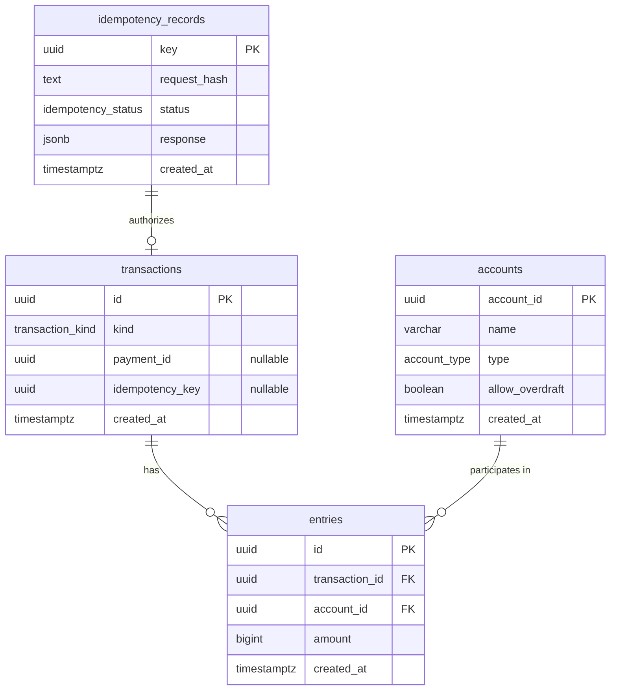
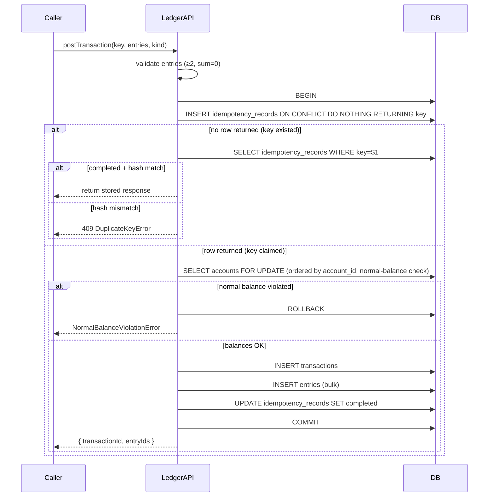

# Design Document

## Overview

`ledger-core` is the foundational accounting package for Ossuary. It implements a double-entry ledger in TypeScript on top of Drizzle ORM and Postgres, exposing three primary operations — `postTransaction`, `balance`, and `refund` — plus account management. Every monetary amount is stored as a `bigint` in minor units (cents or USDC 6-decimal base units). Balances are always derived at read time from `SUM(entries.amount)`; no balance column exists on any table. Every money-moving operation is idempotent via an `Idempotency-Key`. The package runs in production against Neon Postgres and in CI against `pglite` (in-memory Postgres-compatible) with no external dependencies.

The design directly addresses five structural correctness properties that the test suite must falsify with `fast-check`:

1. The global entry sum is always zero.
2. Replaying a `postTransaction` call with the same idempotency key leaves the ledger unchanged.
3. Replaying calls with duplicate keys in any order yields the same final balances.
4. Total refunded per payment never exceeds total captured.
5. A crash at any step leaves the ledger fully committed or fully absent.

---

## Architecture

```
packages/core/
├── src/
│   ├── schema/
│   │   ├── accounts.ts          # accounts table + accountType enum
│   │   ├── transactions.ts      # transactions table + transactionKind enum
│   │   ├── entries.ts           # entries table
│   │   ├── idempotency.ts       # idempotency_records table + status enum
│   │   └── index.ts             # re-exports all schema objects
│   ├── db/
│   │   ├── client.ts            # createDb() factory — Neon vs pglite switching
│   │   └── migrate.ts           # runMigrations() helper
│   ├── ledger/
│   │   ├── postTransaction.ts   # postTransaction implementation
│   │   ├── balance.ts           # balance implementation
│   │   ├── refund.ts            # refund implementation
│   │   ├── accounts.ts          # createAccount, getAccount
│   │   └── hash.ts              # deterministic request-hash function
│   ├── errors/
│   │   └── index.ts             # all typed error classes
│   ├── types/
│   │   └── index.ts             # shared TypeScript types
│   ├── migrations/
│   │   ├── 0000_create_accounts.sql
│   │   ├── 0001_create_transactions.sql
│   │   ├── 0002_create_entries.sql
│   │   ├── 0003_create_idempotency_records.sql
│   │   └── 0004_append_only_trigger.sql
│   └── index.ts                 # public API surface
├── tests/
│   ├── helpers/
│   │   └── createTestDb.ts      # pglite test-DB factory
│   ├── unit/
│   │   ├── hash.test.ts
│   │   └── accounts.test.ts
│   └── property/
│       ├── entrySum.property.ts         # Property 1
│       ├── idempotency.property.ts      # Property 2 & 3
│       ├── refundCap.property.ts        # Property 4
│       └── atomicity.property.ts        # Property 5
├── drizzle.config.ts
├── package.json
└── tsconfig.json
```

The dependency flow is strictly one-way: `ledger/` → `schema/` + `errors/` + `types/`; `db/` is injected as a parameter so tests swap the driver without touching business logic.

---

## Components and Interfaces

### `db/client.ts` — Database factory

```ts
import { drizzle } from 'drizzle-orm/neon-serverless';
import { drizzle as drizzlePglite } from 'drizzle-orm/pglite';
import * as schema from '../schema/index.js';

export type Db = ReturnType<typeof drizzle>;

export function createDb(connectionString: string): Db {
  if (connectionString === 'pglite') {
    // resolved at test time — see createTestDb()
    throw new Error('Use createTestDb() in tests');
  }
  const { Pool } = require('@neondatabase/serverless');
  const pool = new Pool({ connectionString });
  return drizzle(pool, { schema });
}
```

Production code receives a `Db` via dependency injection. Tests pass a `pglite`-backed `Db` from `createTestDb()`.

### `ledger/hash.ts` — Deterministic request hash

```ts
import { createHash } from 'node:crypto';

export function hashPayload(payload: unknown): string {
  const canonical = JSON.stringify(payload, Object.keys(payload as object).sort());
  return createHash('sha256').update(canonical).digest('hex');
}
```

Keys are sorted before stringification so field-order differences in equivalent payloads produce the same hash. Any field-level difference (amount, account, kind) produces a different hash.

### `errors/index.ts` — Typed errors

```ts
export class LedgerError extends Error {}

export class UnbalancedTransactionError extends LedgerError {
  constructor(public readonly sum: bigint) {
    super(`Transaction entries sum to ${sum}, expected 0`);
  }
}

export class InsufficientEntriesError extends LedgerError {
  constructor() { super('A transaction requires at least 2 entries'); }
}

export class DuplicateKeyError extends LedgerError {
  constructor(public readonly key: string) {
    super(`Idempotency key already claimed with a different payload: ${key}`);
  }
}

export class AccountNotFoundError extends LedgerError {
  constructor(public readonly accountId: string) {
    super(`Account not found: ${accountId}`);
  }
}

export class DuplicateAccountError extends LedgerError {
  constructor(public readonly accountId: string) {
    super(`Account already exists: ${accountId}`);
  }
}

export class MissingFieldError extends LedgerError {
  constructor(public readonly field: string) {
    super(`Required field missing: ${field}`);
  }
}

export class InvalidAccountTypeError extends LedgerError {
  constructor(public readonly value: string) {
    super(`Invalid account type: ${value}`);
  }
}

export class NormalBalanceViolationError extends LedgerError {
  constructor(public readonly accountId: string, public readonly balance: bigint) {
    super(`Account ${accountId} would cross its normal balance: ${balance}`);
  }
}

export class RefundCapExceededError extends LedgerError {
  constructor(public readonly requested: bigint, public readonly remaining: bigint) {
    super(`Refund of ${requested} exceeds remaining refundable amount ${remaining}`);
  }
}

export class PaymentNotFoundError extends LedgerError {
  constructor(public readonly paymentId: string) {
    super(`No captured transactions found for payment: ${paymentId}`);
  }
}

export class IdempotencyWindowExpiredError extends LedgerError {
  constructor(public readonly key: string) {
    super(`Idempotency key ${key} is older than 24 hours`);
  }
}

export class MissingIdempotencyKeyError extends LedgerError {
  constructor() { super('An idempotency key is required'); }
}

export class InvalidRefundAmountError extends LedgerError {
  constructor(public readonly amount: bigint) {
    super(`Refund amount must be > 0, got ${amount}`);
  }
}
```

### `types/index.ts` — Shared types

```ts
export type AccountType = 'asset' | 'liability' | 'revenue' | 'expense';
export type TransactionKind = 'capture' | 'refund' | 'transfer';
export type IdempotencyStatus = 'in_progress' | 'completed';

export interface Account {
  accountId: string;
  name: string;
  type: AccountType;
  allowOverdraft: boolean;
  createdAt: Date;
}

export interface Transaction {
  id: string;
  kind: TransactionKind;
  paymentId: string | null;
  idempotencyKey: string | null;
  createdAt: Date;
}

export interface Entry {
  id: string;
  transactionId: string;
  accountId: string;
  amount: bigint;
  createdAt: Date;
}

export interface IdempotencyRecord {
  key: string;
  requestHash: string;
  status: IdempotencyStatus;
  response: unknown;
  createdAt: Date;
}

export interface EntryInput {
  accountId: string;
  amount: bigint; // positive = debit, negative = credit
}

export interface PostTransactionInput {
  idempotencyKey: string;
  entries: EntryInput[];
  kind: TransactionKind;
  paymentId?: string;
}

export interface RefundInput {
  idempotencyKey: string;
  paymentId: string;
  amount: bigint;
}
```

### `index.ts` — Public API surface

```ts
export { createAccount, getAccount } from './ledger/accounts.js';
export { postTransaction } from './ledger/postTransaction.js';
export { balance } from './ledger/balance.js';
export { refund } from './ledger/refund.js';
export { createDb } from './db/client.js';
export { runMigrations } from './db/migrate.js';
export * from './types/index.js';
export * from './errors/index.js';
```

Nothing from `schema/` is exported — that is an internal implementation detail.

---

## Data Models

### Drizzle Schema

**`schema/accounts.ts`**

```ts
import { pgTable, pgEnum, uuid, varchar, boolean, timestamp } from 'drizzle-orm/pg-core';

export const accountType = pgEnum('account_type', [
  'asset', 'liability', 'revenue', 'expense',
]);

export const accounts = pgTable('accounts', {
  accountId:     uuid('account_id').primaryKey(),
  name:          varchar('name', { length: 255 }).notNull(),
  type:          accountType('type').notNull(),
  allowOverdraft: boolean('allow_overdraft').notNull().default(false),
  createdAt:     timestamp('created_at', { withTimezone: true })
                   .notNull()
                   .defaultNow(),
});
```

**`schema/transactions.ts`**

```ts
import { pgTable, pgEnum, uuid, timestamp } from 'drizzle-orm/pg-core';
import { idempotencyRecords } from './idempotency.js';

export const transactionKind = pgEnum('transaction_kind', [
  'capture', 'refund', 'transfer',
]);

export const transactions = pgTable('transactions', {
  id:              uuid('id').primaryKey(),
  kind:            transactionKind('kind').notNull(),
  paymentId:       uuid('payment_id'),              // nullable
  idempotencyKey:  uuid('idempotency_key')
                     .references(() => idempotencyRecords.key), // nullable FK → idempotency_records.key
  createdAt:       timestamp('created_at', { withTimezone: true })
                     .notNull()
                     .defaultNow(),
});
```

No amount column. No balance column.

**`schema/entries.ts`**

```ts
import { pgTable, uuid, bigint, timestamp } from 'drizzle-orm/pg-core';
import { transactions } from './transactions.js';
import { accounts } from './accounts.js';

export const entries = pgTable('entries', {
  id:            uuid('id').primaryKey(),
  transactionId: uuid('transaction_id')
                   .notNull()
                   .references(() => transactions.id),
  accountId:     uuid('account_id')
                   .notNull()
                   .references(() => accounts.accountId),
  amount:        bigint('amount', { mode: 'bigint' }).notNull(),  // the ONLY monetary column
  createdAt:     timestamp('created_at', { withTimezone: true })
                   .notNull()
                   .defaultNow(),
});
```

#### Append-only trigger (migration `0004`)

```sql
CREATE OR REPLACE FUNCTION entries_no_mutate()
RETURNS TRIGGER LANGUAGE plpgsql AS $$
BEGIN
  RAISE EXCEPTION 'entries are append-only: % on entries is forbidden', TG_OP;
END;
$$;

CREATE TRIGGER entries_append_only
  BEFORE UPDATE OR DELETE ON entries
  FOR EACH ROW EXECUTE FUNCTION entries_no_mutate();
```

This trigger is the database-level enforcement of the append-only requirement (Req 2.4). It makes the constraint impossible to violate from any application path, ORM bypass, or direct SQL — not merely a convention.

**`schema/idempotency.ts`**

```ts
import { pgTable, pgEnum, uuid, text, jsonb, timestamp, uniqueIndex } from 'drizzle-orm/pg-core';

export const idempotencyStatus = pgEnum('idempotency_status', [
  'in_progress', 'completed',
]);

export const idempotencyRecords = pgTable(
  'idempotency_records',
  {
    key:         uuid('key').primaryKey(),
    requestHash: text('request_hash').notNull(),
    status:      idempotencyStatus('status').notNull(),
    response:    jsonb('response'),
    createdAt:   timestamp('created_at', { withTimezone: true })
                   .notNull()
                   .defaultNow(),
  },
  (table) => ({
    keyIdx: uniqueIndex('idempotency_records_key_idx').on(table.key),
  }),
);
```

The `uniqueIndex` on `key` is the serialization primitive for concurrent duplicate requests — Postgres blocks the second INSERT until the first transaction commits or rolls back.

### Entity-Relationship Diagram



---

## Operation Flows

### `postTransaction(idempotencyKey, entries, kind, paymentId?, tx?)`

> `postTransaction` accepts an optional `tx` parameter (an open Drizzle transaction handle). When `tx` is supplied (called from `refund`), `postTransaction` skips the `db.transaction()` wrapper and the idempotency-claim step (steps 4–6) and uses `tx` for all DB operations, joining the caller's transaction. When `tx` is absent, `postTransaction` opens its own transaction as described below.

This is the core write path. All steps execute inside a single `db.transaction()` call.

**Happy path:**

1. Validate `idempotencyKey` is present — throw `MissingIdempotencyKeyError` if absent (before opening any transaction).
2. Validate entry list: ≥ 2 entries — throw `InsufficientEntriesError` if fewer.
3. Validate entry sum: compute `entries.reduce((s, e) => s + e.amount, 0n)` — throw `UnbalancedTransactionError(sum)` if `sum !== 0n`. All arithmetic is `bigint`; no floats.
4. Begin `db.transaction()`.
5. Compute `requestHash = hashPayload({ entries, kind, paymentId })`.
6. Claim the idempotency key with:
   ```sql
   INSERT INTO idempotency_records (key, request_hash, status, created_at)
   VALUES ($key, $hash, 'in_progress', now())
   ON CONFLICT (key) DO NOTHING
   RETURNING key
   ```
   - If the INSERT returns a row: the key is now claimed; continue to step 7.
   - If the INSERT returns no row (key already existed): read the existing record with `SELECT … WHERE key = $key`.
     - If `status = 'completed'` and `request_hash` matches: check `created_at`; if older than 24 h throw `IdempotencyWindowExpiredError`; otherwise return the stored `response` and exit (no further DB writes).
     - If `request_hash` differs: throw `DuplicateKeyError` (409 Conflict); roll back.
     - If `status = 'in_progress'`: the first caller's transaction has not committed yet; this means the first caller is still holding a row lock that prevents the `DO NOTHING` path from resolving — the duplicate caller should not loop-read but instead throw a retriable conflict error indicating the key is in-flight.
7. Acquire row locks on every account referenced by the entries: execute
   ```sql
   SELECT account_id, type, allow_overdraft
   FROM accounts
   WHERE account_id = ANY($accountIds)
   ORDER BY account_id   -- ascending order prevents deadlocks
   FOR UPDATE
   ```
   If any `account_id` from the entries is missing from the result set, throw `AccountNotFoundError` for that account.
   Then, for each entry, compute the prospective balance (`current balance + entry.amount`) using the locked account rows. Apply the normal-balance check (asset/expense: reject if < 0; liability/revenue: reject if > 0; skip if `allow_overdraft = true`). Because the rows are locked, no concurrent transaction can modify these accounts' entries until this transaction commits or rolls back.
8. `INSERT INTO transactions (id, kind, payment_id, idempotency_key)`.
9. `INSERT INTO entries (id, transaction_id, account_id, amount)` for every entry in a single bulk insert.
10. `UPDATE idempotency_records SET status = 'completed', response = $response WHERE key = $key`.
11. COMMIT.
12. Return the stored response (transaction id + entry ids).

**On any error at steps 7–10:** the `db.transaction()` rolls back atomically, leaving the idempotency key unclaimed and no entries written.

**Postgres serialization guarantees relied upon:**
- The unique constraint on `idempotency_records(key)` acts as a mutex for concurrent duplicates; `ON CONFLICT DO NOTHING` avoids aborting the transaction on a duplicate key.
- Postgres runs explicit transactions at READ COMMITTED isolation by default. This spec does not require REPEATABLE READ because all shared-state reads that require consistency are protected by explicit row locks (`SELECT … FOR UPDATE`) rather than relying on snapshot isolation.
- `SELECT … FOR UPDATE` on account rows (ordered by `account_id` ascending) prevents concurrent transactions from interleaving balance-modifying writes between the balance read and the entry insert, and the ascending-order locking prevents deadlocks between transactions that touch overlapping account sets.

### `balance(accountId)`

This is a pure read path; no transaction wrapping is required.

1. Verify the account exists: `SELECT 1 FROM accounts WHERE account_id = $1 LIMIT 1`. If absent, throw `AccountNotFoundError`.
2. `SELECT COALESCE(SUM(amount), 0) AS bal FROM entries WHERE account_id = $1`.
3. Cast result to `bigint` and return.

The balance is derived fresh on every call. No cached or stored balance column is consulted.

### `refund(idempotencyKey, paymentId, amount)`

Refund delegates to `postTransaction` for entry writing, but adds idempotency-first ordering and cap enforcement inside the same database transaction.

1. Validate `amount > 0n` — throw `InvalidRefundAmountError` if not.
2. Validate `idempotencyKey` is present — throw `MissingIdempotencyKeyError` if absent.
3. Begin `db.transaction()`.
4. **Claim the idempotency key first** (before any cap check), using the same `INSERT … ON CONFLICT DO NOTHING RETURNING` pattern described in `postTransaction` step 6. If the key already exists and `status = 'completed'` with a matching hash, return the stored response immediately — the refund already succeeded.
5. Verify payment exists: `SELECT id FROM transactions WHERE kind = 'capture' AND payment_id = $paymentId LIMIT 1 FOR UPDATE`. If no rows, throw `PaymentNotFoundError` and roll back.
6. Lock the payment's capture transactions:
   ```sql
   SELECT id FROM transactions
   WHERE kind = 'capture' AND payment_id = $paymentId
   FOR UPDATE
   ```
7. Compute `captured`: sum of positive `entries.amount` where `transaction_id` is in the locked capture set.
8. Compute `alreadyRefunded`: sum of positive `entries.amount` where `transaction_id IN (SELECT id FROM transactions WHERE kind = 'refund' AND payment_id = $paymentId)` — also lock these rows with `FOR UPDATE`.
9. Compute `remaining = captured − alreadyRefunded`.
10. If `amount > remaining`: throw `RefundCapExceededError(amount, remaining)` and roll back.
11. Build the refund entry list (negated amounts from the original capture entries, routed appropriately).
12. Call `postTransaction(idempotencyKey, refundEntries, 'refund', paymentId, tx)`, passing the current open transaction handle `tx` so the cap check and the entry write commit in the same atomic unit. `postTransaction` skips the `BEGIN` and idempotency-claim steps when a transaction handle is passed (the key was already claimed in step 4 above).
13. COMMIT.

**Postgres serialization guarantee relied upon:**
- `SELECT FOR UPDATE` on the capture transactions rows locks them for the duration of the outer transaction, preventing concurrent refunds from both passing the cap check with the same `remaining` value.
- Claiming the idempotency key first (step 4) ensures a replay of an already-completed refund returns the stored response immediately, before the cap check runs against a fully-consumed `remaining` balance.

### Operation Flow Diagram



---

## Correctness Properties

*A property is a characteristic or behavior that should hold true across all valid executions of a system — essentially, a formal statement about what the system should do. Properties serve as the bridge between human-readable specifications and machine-verifiable correctness guarantees.*

### Property 1: Global entry sum is always zero

*For any* sequence of `postTransaction` calls where each call supplies two or more `bigint` entry amounts that sum to zero, the sum of **every** entry amount persisted in the ledger SHALL equal zero after each call in the sequence.

**Validates: Requirements 2.7**

#### Append-only enforcement

The append-only constraint is enforced at two levels:
1. **Application layer**: `postTransaction` only issues `INSERT` statements; no `UPDATE` or `DELETE` path exists on the `entries` table in the application code.
2. **Database layer**: migration `0004` installs a `BEFORE UPDATE OR DELETE` trigger on `entries` that raises an exception, making the constraint unbypassable regardless of how the database is accessed.

### Property 2: Idempotency replay leaves the ledger unchanged

*For any* valid `postTransaction` call, replaying it with the same `idempotency_key` any number of times (N ≥ 1) within the 24-hour retention window SHALL produce exactly the same set of ledger entries as a single execution — no additional entries, no modified entries.

**Validates: Requirements 3.8**

### Property 3: Replay in any order with duplicates yields the same balances

*For any* set of distinct `postTransaction` calls, delivering those calls in any permutation and any number of duplicate replays of each SHALL produce the same final account balances as delivering each distinct call exactly once in the original order.

**Validates: Requirements 9.3**

### Property 4: Total refunded per payment never exceeds total captured

*For any* `payment_id` and any sequence of `refund` calls against it, the sum of positive entry amounts across all `kind = 'refund'` transactions for that payment SHALL be less than or equal to the sum of positive entry amounts across all `kind = 'capture'` transactions for that payment, after every call in the sequence.

**Validates: Requirements 5.7**

### Property 5: Boundary — exact remaining amount accepted, one unit over rejected

*For any* `payment_id` with a known remaining refundable amount `R` (computed as `captured − alreadyRefunded`), a `refund` call for exactly `R` SHALL be accepted and produce a successful ledger write, and a subsequent `refund` call for `R + 1n` SHALL be rejected with a `RefundCapExceededError` with no ledger entries written for the rejected call.

**Validates: Requirements 5.8**

### Property 6: Crash at any step leaves the ledger fully committed or fully absent

*For any* `postTransaction` call and any injection point within its execution (before the idempotency INSERT, after the idempotency INSERT but before the entry INSERTs, after the entry INSERTs but before the idempotency UPDATE), simulating a crash at that point SHALL leave the database in one of exactly two states: either all of the following are present — the idempotency record, all ledger entries, and the stored response — or none of them are present. No intermediate state is permissible.

**Validates: Requirements 7.4**

---

## Error Handling

### Validation errors (before any DB write)

| Error | Trigger | HTTP analogue |
|---|---|---|
| `MissingIdempotencyKeyError` | `postTransaction` or `refund` called without a key | 400 |
| `InsufficientEntriesError` | Fewer than 2 entries supplied | 400 |
| `UnbalancedTransactionError` | Entry amounts do not sum to 0n | 400 |
| `MissingFieldError` | Account creation missing required field | 400 |
| `InvalidAccountTypeError` | Account type not in enum | 400 |
| `InvalidRefundAmountError` | Refund amount ≤ 0 | 400 |

### Business-rule errors (discovered during the DB transaction)

| Error | Trigger | HTTP analogue |
|---|---|---|
| `NormalBalanceViolationError` | Post-transaction balance crosses normal-balance side | 422 |
| `RefundCapExceededError` | Requested refund would exceed captured amount | 422 |
| `AccountNotFoundError` | Entry references a non-existent account | 404 |
| `PaymentNotFoundError` | Refund targets a non-existent payment_id | 404 |
| `DuplicateAccountError` | Account creation with an existing account_id | 409 |

### Idempotency errors

| Error | Trigger | HTTP analogue |
|---|---|---|
| `DuplicateKeyError` | Same key, different payload hash | 409 |
| `IdempotencyWindowExpiredError` | Key exists but is older than 24 hours | 410 |

### Error invariants

- Every error thrown before `db.transaction()` opens leaves the database untouched.
- Every error thrown inside `db.transaction()` triggers a full rollback: no idempotency record is left in `in_progress`, no entries are partially written.
- Errors are typed subclasses of `LedgerError`; callers can narrow with `instanceof` without parsing message strings.

---

## Testing Strategy

### Framework and tooling

- **Vitest** (`vitest --run`) as the test runner. No watch mode in CI; timeout: 120 s.
- **fast-check** for all property-based tests. Minimum 100 iterations per property (`numRuns: 100`).
- **pglite** (`@electric-sql/pglite` + `drizzle-orm/pglite` adapter) as the in-memory Postgres backend. No network access, no environment variables needed.
- **Playwright** is out of scope for this package (apps only).

### `tests/helpers/createTestDb.ts` — pglite test factory

```ts
import { PGlite } from '@electric-sql/pglite';
import { drizzle } from 'drizzle-orm/pglite';
import { migrate } from 'drizzle-orm/pglite/migrator';
import * as schema from '../../src/schema/index.js';

export type TestDb = ReturnType<typeof drizzle>;

export async function createTestDb(): Promise<TestDb> {
  const client = new PGlite();                   // in-memory, no file, no network
  const db = drizzle(client, { schema });
  await migrate(db, { migrationsFolder: './src/migrations' });
  return db;
}
```

Each `describe` block calls `createTestDb()` in `beforeAll` (or each `test` calls it for stricter isolation). No environment variables are read. The function is synchronous from the caller's perspective (top-level `await` in test files).

### Unit tests (`tests/unit/`)

Cover specific examples and error conditions:

- `hash.test.ts`: identical payloads → same hash; single-field difference → different hash.
- `accounts.test.ts`: create/retrieve round-trip; missing-field rejection; duplicate-id rejection; invalid-type rejection.
- `appendOnly.test.ts`: attempts an UPDATE and a DELETE on an `entries` row after a successful `postTransaction`. Both operations must throw a database error containing the text `"append-only"`. This test verifies that the trigger from migration `0004` is active and correctly rejects mutations at the DB level, not merely at the application layer.
- Inline edge cases for `InsufficientEntriesError`, `UnbalancedTransactionError`, `MissingIdempotencyKeyError`.

Unit tests use concrete, hand-crafted inputs. They do not use fast-check.

### Property-based tests (`tests/property/`)

Each file implements one or more of the six correctness properties. Each property test is tagged with a comment in the format:

```
// Feature: ledger-core, Property N: <property text>
```

**`entrySum.property.ts`** — Property 1

```
Arbitrary: fc.array(validTransactionArb, { minLength: 1, maxLength: 200 })
Invariant: after each postTransaction, SUM(entries.amount) === 0n
```

**`idempotency.property.ts`** — Properties 2 & 3

```
Arbitrary (P2): validTransactionArb × fc.integer({ min: 1, max: 50 }) (replay count)
Invariant (P2): account balances and entry count unchanged after replay N

Arbitrary (P3): fc.array(validTransactionArb, { minLength: 1, maxLength: 20 })
                × fc.shuffledSubarray of those transactions with duplicates
Invariant (P3): final balances equal those produced by applying each distinct key once
```

**`refundCap.property.ts`** — Properties 4 & 5

```
Arbitrary (P4): captureTransactionArb × fc.array(refundArb, { minLength: 0, maxLength: 20 })
Invariant (P4): totalRefunded ≤ totalCaptured after every refund in sequence

Arbitrary (P5): captureTransactionArb × fc.bigInt({ min: 0n }) for prior refunds
Invariant (P5): refund(R) succeeds; refund(R+1) throws RefundCapExceededError; no entries for rejected call
```

**`atomicity.property.ts`** — Property 6 (Poltergeist)

```
Arbitrary: validTransactionArb × fc.integer({ min: 0, max: NUM_STEPS - 1 }) (crash point)
Invariant: after simulated crash at step N, DB contains either all three artifacts
           (idempotency record, entries, completed status) or none of them;
           and SUM(entries.amount) === 0n in both cases.
```

Crash simulation: a wrapper around `db.transaction()` that throws at step N after each individual SQL statement. Because pglite runs in-process, the simulated crash is simply throwing before `COMMIT`, which triggers Drizzle's automatic rollback.

### Property test configuration

```ts
// vitest.config.ts
export default {
  test: {
    testTimeout: 120_000,
  },
};
```

```ts
// shared fast-check runner config
fc.assert(fc.property(...), { numRuns: 100, verbose: true });
```

Each property test references its design property by number in the tag comment so test failures can be traced back to this document.
