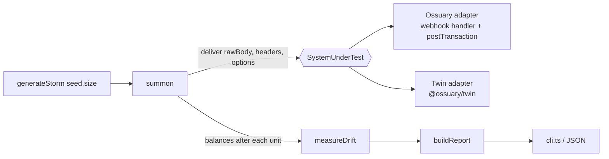

# Design Document

## Overview

The poltergeist is a fault injector with a visible result. It generates a seeded **storm** of haunted deliveries, throws it at a **system under test** (SUT), and reports how much money **drifted**. The demo runs the same storm against Ossuary and against the Vibe Pay twin and shows the two drift meters side by side.

A run has four stages:

1. **Generate.** `generateStorm({ seed, size })` produces a list of **units** from a seeded PRNG. Each unit is either a **ghost** (one instance of a fault from the catalog) or an **honest unit** (one capture delivered once). Every ghost brings its own payments and its own money, so its true effect on the books is known when it is generated.
2. **Summon.** `summon({ storm, factory })` creates a SUT instance and plays both the rail and the app client. It signs webhooks, sends payouts with idempotency keys, replays old requests, races requests, injects crashes and retries. Units run one at a time.
3. **Measure.** After each unit, the runner reads `balances()` and compares them with the truth. The change in drift across the unit is that unit's **drift delta**, so every cent of drift is attributed to the ghost that caused it.
4. **Report.** A versioned JSON report holds the counts per fault, the final drift, the blocked ghosts with their epitaphs, the drifted ghosts and a counterexample. The CLI prints it.

Everything runs on pglite with an injected virtual clock. Amounts are `bigint` minor units of USDC (6 decimals), and there is no conversion anywhere.

### Facts this design is built on

I checked these against the current code and with a scratch test that has since been deleted:

- **Webhook cost.** A signed `payment.captured` delivery through `createWebhookHandler` costs about 2.7 ms on pglite. It rises to about 4.3 ms once the database holds a few hundred events.
- **Database setup cost.** A freshly migrated pglite costs about 0.5 s once the WASM module is warm. A cold bare boot is about 0.8 s.
- **The existing suite.** It takes 39.3 s (33 files, 248 tests).
- **pglite serializes transactions.** Two `db.transaction` calls started together with `Promise.all` ran strictly one after the other: `A:start A:end B:start B:end`.
- **Double-taps on Ossuary.** Two concurrent `postTransaction` calls with the same key and payload returned the same transaction id.
- **Lost updates on a naive twin.** A read-modify-write on a balance column, with no transaction, started twice concurrently on one pglite, loses an update deterministically: it ended at 700 where 600 was correct. The twin's race faults therefore show up on pglite, while Ossuary's transactions are serialized there.
- **Extra webhook fields.** `parseEvent` ignores fields it does not know, so the rail can add `circleId` and `memberId` to the body without any change to `webhooks-outbox`.
- **Running TypeScript.** Node 24 is installed, but Node does not rewrite the `.js` import specifiers this package uses into `.ts`. No TypeScript runner is installed (`tsx`, `vite-node` and `ts-node` are all absent). The CLI therefore needs `tsx` as a new dev dependency.
- **Generating the twin.** `kiro-cli` is installed at `/opt/homebrew/bin/kiro-cli`, and there is no user-level `~/.kiro/steering`. The twin can therefore be generated headless in an empty directory with no steering.

---

## Design Decisions

### D1. Ghosts are self-funded and run one at a time

Each ghost creates its own payments, and pays any payout only from money it captured itself. Units never overlap. Two things follow:

- **The truth is known per ghost**, so the drift delta of a ghost is exactly the damage that ghost did. Attribution needs no heuristics.
- **No payout can be invalid in the truth.** The pot never has to cover money it does not hold. For a refund racing a payout, the generator keeps `refund + payout ≤ capture`, so every serial order of the race is valid. Ossuary must then end with exactly the truth whichever request wins the lock.

What this gives up is interleaving between different ghosts. That is covered already: `webhooks-outbox` Property 2 permutes and duplicates deliveries across payments, and the poltergeist's job is the visible, attributable demo.

### D2. Payouts are app requests, not webhooks

The tontine pays the pot to a member when the organiser presses a button, so a payout is an app request with an `idempotency-key` header (`idempotency.md`), not a rail event. This is where "concurrent double-taps on the same idempotency key" and "a refund racing a payout" live.

- **In Ossuary**, a payout is a `transfer` through `postTransaction`: debit the pot (revenue) and credit the member's wallet (liability), with the key from the header. The pot's normal-balance check stops it going below zero.
- **The glue** lives in the Ossuary adapter, about 40 lines. It is not a new core API (Open question Q2).

### D3. Drift is expected minus reported, over the pot and the member wallets

| Account | Expected (from truth) | Reported (from the SUT) |
|---|---|---|
| `pot` | captured − refunded − paid out | the pot balance |
| `member:mN` | paid out to member `mN` | that member's wallet |

`drift(account) = expected − reported`. A positive value is **lost** money, and a negative value is **conjured** money. The total is the sum over accounts. Because the expected values sum to `captured − refunded`, the total equals money in, minus money out (refunds back to payers), minus money held (pot plus wallets), which is exactly the meter the prompt describes.

Splitting the result per account catches drift that the total alone would hide. For example, a double-tap with a lost update leaves the pot correct but pays the member twice. The total still shows it: it conjures one payout.

- **Conjured money** is `Σ max(0, reported − expected)`.
- **Lost money** is `Σ max(0, expected − reported)`.
- **A double-credited member** is one whose reported wallet exceeds the expected one.

### D4. "Blocked" means zero drift; "buried by" names only defenses the SUT reported

A ghost is **blocked** when its drift delta is zero on every account, whatever the target. The epitaph's `{fate}` is filled from **observed** defenses only:

- `buried by inbox dedupe`, when the Ossuary adapter saw a `duplicate` outcome;
- `passed without drift`, when no defense was reported.

The twin never reports a defense. So a twin ghost that happens to do no harm, such as an out-of-order delivery that ends in the right place, is listed as `passed without drift` and is never credited with a defense it does not have.

### D5. One crash model for both targets

A crash plan says "before step k", where a step is one SQL statement the SUT issues for that delivery.

- **If the SUT reaches step k**, the statement throws `SimulatedCrash` and the delivery gets no response. For the twin, every later statement of the delivery also fails, because its process is dead. For Ossuary, the existing one-shot crash helper is equivalent: after the error, Ossuary issues only rollbacks. A unit test proves this (task 4.3).
- **If the delivery finishes in k steps or fewer**, the crash happens after it finished and before the response reaches the rail. That is the "after commit" case.

Every crash plan therefore crashes exactly once. The rail (or the client, for a payout) then retries as Requirement 3.6 describes.

### D6. Shared helpers move into `src/poltergeist/` and are re-exported

The CLI and the adapters live in `src/`, and `src/` cannot import `tests/`. The parts of the shared helpers that `src/` needs therefore move:

- `fakeClock`;
- `createCrashingDb`, `SimulatedCrash`, `CrashPoint` and `describeCrashPoint`;
- `fakeSender`;
- `signedDelivery` and `signedDeliveryAt`.

The existing `tests/helpers/*.ts` files re-export them under the same names, so no existing test file changes. `calibrate` stays in `tests/helpers/crash.ts`, because it uses Vitest's `expect`. The fast-check arbitraries stay in `tests/helpers/`.

### D7. Determinism

The report must be byte-identical for the same seed, size, options and target. The design makes sure of that in four ways:

1. **One seeded PRNG.** The storm uses a single seeded PRNG (`mulberry32`) and nothing else that is random.
2. **Logical ids only.** Storms and reports use logical ids (`evt_9f3a01c2`, `pay_…`, `key_…`, `m0`…`m4`). Concrete ids are derived per SUT instance from a random Run_Tag, which lets tests share one database across runs, and they never reach the report.
3. **No times or environment data.** The report holds no wall-clock time, duration, secret or concrete id.
4. **Deterministic concurrency.** Concurrent deliveries are started in storm order. On pglite the interleaving is then deterministic: transactions are serialized, and the twin's un-transacted queries are queued in submission order. Property 1 checks this.

### D8. The library entry is browser-safe; Node-only code lives in `cli.ts`

The Tontine and Tip Jar apps run the storm live in the page, on PGlite. Every module under `src/poltergeist/` except `cli.ts` must therefore load in a browser bundle (Requirement 14):

- **No Node built-ins.** No `fs`, `path`, `url`, `module`, `os` or `child_process` import, and no use of the `process` or `Buffer` globals in poltergeist code.
- **Only `node:crypto`, only what core already uses.** The one Node built-in still reachable, through core's webhook and ledger modules, is `node:crypto`, and only for `randomUUID`, `createHash`, `createHmac` and `timingSafeEqual`, which app bundlers shim. New randomness in the poltergeist (the signing secret, the run tag) uses `globalThis.crypto.getRandomValues`, which both browsers and Node 22+ provide.
- **Embedded migrations.** `runMigrations` cannot be used, because it reaches `node:fs` and `node:url` through drizzle's `readMigrationFiles`. Instead, `src/poltergeist/embeddedMigrations.generated.ts` holds every migration as strings, in the exact `MigrationMeta` shape drizzle builds:
  - `sql`: the file split on `--> statement-breakpoint`;
  - `bps`: the journal's breakpoint flag;
  - `folderMillis`: the journal's `when`;
  - `hash`: SHA-256 of the file, computed when the module is generated.

  `applyEmbeddedMigrations(db)` passes this list to the same `dialect.migrate` call that `runMigrations` makes, so the `drizzle.__drizzle_migrations` history is identical either way. The module is written by `scripts/embed-migrations.ts` (`pnpm --filter core embed-migrations`). A unit test compares it with `readMigrationFiles` on every run, so a new migration that was not embedded fails the suite.
- **A bundle test.** `tests/unit/browserBundle.test.ts` bundles `src/poltergeist/index.ts` with esbuild (`platform: 'browser'`, `format: 'esm'`). A resolve plugin records every import of a Node built-in, static or dynamic, with its importer. `node:crypto` is marked external, and the test also checks that the bundle's named imports from `node:crypto` are a subset of the four functions above. `@electric-sql/pglite` is marked external: a probe bundle showed that PGlite's browser build still contains guarded dynamic imports of `fs`, `zlib` and `stream` for its Node file systems. PGlite is the apps' browser database, so that is its own concern, not core's.
- **A source scan.** The same test scans `src/poltergeist/*.ts`, except `cli.ts`, for `process.` and `Buffer`, because a global is not an import and the bundler cannot flag it.

Core's own webhook code (`verify.ts`, `keys.ts`) uses the `Buffer` global alongside `node:crypto`. That is unchanged, because Requirement 12.4 keeps core's behavior and files as they are. The shims that bundlers use for `node:crypto` (`crypto-browserify`) already depend on the `buffer` polyfill, so the apps' bundler config must provide both. The Tontine spec has to set that up.

### Review outcome

Q1–Q10 were accepted as proposed in review. Q11–Q14 were not raised in review, so this implementation uses the proposed answers for them too. Requirement 14 and D8 were added at review.

---

## Architecture

```
packages/core/
├── package.json                   # + exports "./poltergeist", script "poltergeist"; pglite → dependencies;
│                                  #   + @ossuary/twin (workspace), + tsx (dev)
├── src/
│   ├── poltergeist/
│   │   ├── index.ts               # subpath entry @ossuary/core/poltergeist
│   │   ├── rng.ts                 # mulberry32 + int / bigint / pick / shuffle / hex8
│   │   ├── faults.ts              # FAULTS catalog, FaultId, renderEpitaph, DEFENSE_LABELS
│   │   ├── storm.ts               # generateStorm, Storm / Unit / Step types, stormToJson, isolateUnit
│   │   ├── materialize.ts         # logical → concrete ids per Run_Tag (uuidV5 from webhooks/keys)
│   │   ├── sut.ts                 # SystemUnderTest, SutFactory, createOssuarySut (+ payout route)
│   │   ├── twinSut.ts             # createTwinSut                       (task group 5)
│   │   ├── summon.ts              # summon: rail + client, retries, attribution, counterexample
│   │   ├── drift.ts               # Truth, measureDrift, subtractDrift
│   │   ├── report.ts              # PoltergeistReport, REPORT_VERSION, buildReport, serializeReport
│   │   ├── cli.ts                 # pnpm poltergeist (the only Node-only module, D8)
│   │   ├── embeddedMigrations.generated.ts  # migrations as strings, written by scripts/embed-migrations.ts
│   │   ├── migrate.ts             # applyEmbeddedMigrations(db): browser-safe dialect.migrate
│   │   ├── clock.ts               # fakeClock                  (moved from tests/helpers/clock.ts)
│   │   ├── crash.ts               # createCrashingDb, SimulatedCrash  (moved from tests/helpers/crash.ts)
│   │   ├── sender.ts              # fakeSender                 (moved from tests/helpers/sender.ts)
│   │   └── rail.ts                # signedDelivery, signedDeliveryAt  (moved from tests/helpers/webhooks.ts)
│   └── (ledger, webhooks, outbox, db, schema, types, errors: unchanged)
└── tests/
    ├── helpers/
    │   ├── clock.ts, crash.ts, sender.ts, webhooks.ts   # now re-export from src/poltergeist (calibrate stays)
    │   └── poltergeist.ts         # POLTERGEIST_RUNS, size arbitraries, shared-db SUT factories
    ├── fixtures/
    │   └── report-seed7-size60-ossuary.json             # golden report
    ├── unit/                      # rng, faults, storm, materialize, drift, report, ossuarySut, summon,
    │                              # twin, twinSut, cli, boundaries, embeddedMigrations, browserBundle
    └── property/
        ├── stormDeterminism.property.ts   # Property 1
        ├── ossuaryZeroDrift.property.ts   # Property 2
        ├── twinDrifts.property.ts         # Property 3
        └── blockedGhosts.property.ts      # Property 4

packages/twin/                     # @ossuary/twin, the Vibe Pay twin (task group 5)
├── package.json, tsconfig.json    # scaffolding, listed in PRODUCED.md
├── PRODUCED.md                    # prompt, agent, model, date, command, attempts, trait checklist
└── src/index.ts                   # generated, never hand-edited
```

Dependencies only point one way:

- `poltergeist/` depends on `ledger/`, `webhooks/`, `outbox/`, `db/` and `@ossuary/twin`.
- Nothing in core's money code depends on `poltergeist/`.
- `@ossuary/twin` depends on nothing in this repo.

`tests/unit/boundaries.test.ts` enforces all three by scanning import specifiers.



---

## Components and Interfaces

### `rng.ts`

```ts
export interface Rng {
  u32(): number;                              // next mulberry32 output, 0 … 2^32−1
  int(min: number, max: number): number;      // inclusive, unbiased (rejection sampling)
  bigint(min: bigint, max: bigint): bigint;   // inclusive, from two u32 draws, rejection sampling
  pick<T>(items: readonly T[]): T;
  weighted<T>(items: readonly { weight: number; value: T }[]): T;
  shuffle<T>(items: readonly T[]): T[];       // Fisher–Yates, returns a copy
  hex8(): string;                             // 8 lowercase hex chars from one u32
}
export function createRng(seed: number): Rng; // seed: integer 0 … 2^32−1
```

`mulberry32` is a small, published 32-bit generator. Statistical quality does not matter here; reproducibility does. A unit test pins its first outputs for seeds 0 and 7, so any change to the generator is caught. Nothing in the poltergeist calls `Math.random`.

### `faults.ts`

```ts
export type FaultId =
  | 'duplicate-delivery' | 'replayed-timestamp' | 'out-of-order' | 'refund-before-capture'
  | 'double-tap' | 'crash-mid-step' | 'refund-races-payout' | 'late-after-refund';

export interface Fault {
  readonly id: FaultId;
  readonly name: string;
  readonly epitaph: string;      // contains {subject} and {fate}
  readonly minDeliveries: number;
  readonly maxDeliveries: number; // ≤ 4
}
export const FAULTS: readonly Fault[];          // frozen, catalog order (Requirement 1.1)
export const FAULT_IDS: readonly FaultId[];

export type DefenseId = 'inbox-dedupe' | 'timestamp-check' | 'signature-check' | 'parking' | 'idempotency-key' | 'rollback';
export const DEFENSE_LABELS: Readonly<Record<DefenseId, string>>;
// 'inbox dedupe', 'timestamp check', 'signature check', 'parked until its capture', 'idempotency key', 'transaction rollback'

export function shortSubject(logicalId: string): string;   // 'evt_9f3a01c2' → 'evt_9f…'
export function renderEpitaph(fault: Fault, subject: string, defenses: readonly DefenseId[]): string;
```

| Fault | Min | Max | Subject |
|---|---|---|---|
| `duplicate-delivery` | 2 | 4 | the repeated event |
| `replayed-timestamp` | 2 | 2 | the replayed event |
| `out-of-order` | 2 | 3 | the payment |
| `refund-before-capture` | 2 | 3 | the first early refund |
| `double-tap` | 3 | 4 | the payout's idempotency key |
| `crash-mid-step` | 1 | 2 | the crashed delivery's event or key |
| `refund-races-payout` | 3 | 3 | the racing refund |
| `late-after-refund` | 3 | 3 | the late capture |

The minimums sum to 18. That is the smallest storm `ensureEveryFault` accepts, and the lower bound of Property 3's sizes.

### `storm.ts`

```ts
export const GENERATOR_VERSION = 1;
export const DEFAULT_STORM_SIZE = 2000;
export const MAX_STORM_SIZE = 20_000;
export const MEMBERS = ['m0', 'm1', 'm2', 'm3', 'm4'] as const;
export type MemberRef = (typeof MEMBERS)[number];

export interface StormOptions { seed: number; size?: number; ensureEveryFault?: boolean }

export function generateStorm(options: StormOptions): Storm;   // pure; RangeError on bad input
export function stormToJson(storm: Storm): string;             // bigint → decimal string, fixed key order
export function isolateUnit(storm: Storm, unitId: string): Storm; // one-unit storm, same seed/asset/members
export function prefixStorm(storm: Storm, unitId: string): Storm; // units up to and including unitId
```

Generation runs in one pass over a single `Rng`:

```
remaining = size
if ensureEveryFault:
  for each fault f, in catalog order:
    cap = min(f.maxDeliveries, remaining − Σ minDeliveries of the faults after f)
    emit build(f, cap)
while remaining > 0:
  choice = rng.weighted([each fault: weight 1, honest: weight 1])
  cap = min(4, remaining)
  if choice is honest, or choice.minDeliveries > cap: emit honest   (the draw is consumed, never re-rolled)
  else: emit build(choice, cap)
```

The draw is never re-rolled and the cap is 4 whenever at least 4 deliveries remain. So a smaller size replays a prefix of a larger one (Requirement 2.12), and a failing size can be shrunk without the earlier units changing.

Amounts are drawn as follows, all in `bigint`:

- **Capture:** `C ∈ [2, 10^9]`.
- **One refund:** `[1, C]`.
- **Two refunds:** `R1 ∈ [1, C − 1]`, then `R2 ∈ [1, C − R1]`.
- **Double-tap or crashed payout:** `P ∈ [1, C]`.
- **A race:** `R ∈ [1, C − 1]` and `P ∈ [1, C − R]`, paid to a member other than the payer.
- **Replay age:** `[301, 604 800]` seconds.
- **Crash step:** `[0, 24]`.

An amount of at most 10^9 keeps any sum over 20,000 deliveries below 2^53. A twin that keeps base units in a JS `number` is therefore exact on honest traffic, and any drift it shows comes from the faults, not from float precision (Q11).

### `materialize.ts`

```ts
export const POLTERGEIST_NAMESPACE: string; // a fixed UUID
export interface Concrete {
  circleId: string; memberIds: Record<MemberRef, string>;
  eventId(logical: string): string;    // runTag + logical
  paymentId(logical: string): string;  // uuidV5(NS, `${runTag}|${logical}`)
  key(logical: string): string;        // uuidV5(NS, `${runTag}|${logical}`)
  memberRef(memberId: string): MemberRef | 'unknown';
}
export function materialize(runTag: string): Concrete;
export function newRunTag(): string;   // 7 random hex chars (globalThis.crypto) + '~'
```

It reuses `uuidV5` from `src/webhooks/keys.ts`. The run tag is the only random input to a run, and it never reaches the report.

### `sut.ts`

```ts
export type Target = 'ossuary' | 'twin';
export type Route = 'webhook' | 'payout';
export interface CrashPlan { beforeStep: number }

export interface DeliverOptions { route: Route; crash?: CrashPlan }
export interface DeliveryResult {
  status: number | null;       // null: crashed before a response reached the caller
  crashed: boolean;
  defense: DefenseId | null;
}
export interface BalanceSnapshot {
  asset: string;
  pot: bigint;
  members: ReadonlyMap<string, bigint>;            // concrete member id → wallet
  fractional?: readonly { account: string; value: string }[]; // twin only (Requirement 11.4)
}
export interface SystemUnderTest {
  readonly target: Target;
  deliver(rawBody: string, headers: Readonly<Record<string, string>>, options: DeliverOptions): Promise<DeliveryResult>;
  balances(): Promise<BalanceSnapshot>;
  settle(): Promise<void>;
  close(): Promise<void>;
}
export interface SutContext {
  circleId: string; memberIds: readonly string[]; asset: string;
  clock: FakeClock; secret: string; runTag: string;
}
export type SutFactory = (ctx: SutContext) => Promise<SystemUnderTest>;

export function ossuaryFactory(options?: { client?: PGlite }): SutFactory;
```

#### `createOssuarySut`

Setup:

1. If no client is supplied, create `new PGlite()` and run `applyEmbeddedMigrations` (D8). Wrap the client with `createCrashingDb(client)`, and use `crashing.db` for every call.
2. Create the accounts with `createAccount`:
   - `clearing`: `asset`, with overdraft;
   - `pot`: `revenue`;
   - `wallet[m]`: `liability`, one per member.
3. Create the webhook handler with `createWebhookHandler(crashing.db, { secret, asset, clearingAccountId, revenueAccountId: pot, clock })`.

`deliver`:

1. If `options.crash` is set, `crashing.arm({ at: 'statement', index: beforeStep })`.
2. Route:
   - `webhook`: `handler({ rawBody, headers })`;
   - `payout`: `handlePayout(rawBody, headers)` (below).
3. Map the result:
   - **The crash fired:** `{ status: null, crashed: true, defense: 'rollback' }`. Every Ossuary write runs inside a transaction, so a statement crash always precedes commit.
   - **The crash was armed but did not fire:** the delivery finished in `beforeStep` steps or fewer. Disarm, then return `{ status: null, crashed: true, defense: null }`. This is the after-commit crash: the work is committed but the caller never hears.
   - **Otherwise:** return the status, with a defense from the table below.

| Response | Defense |
|---|---|
| webhook `200`, outcome `duplicate` | `inbox-dedupe` |
| webhook `200`, outcome `parked` | `parking` |
| webhook `401`, and `verifyWebhook(...)` reports `stale` or `future` | `timestamp-check` |
| webhook `401`, any other reason | `signature-check` |
| payout `200` with a transaction id this instance returned before | `idempotency-key` |
| anything else | `null` |

The `401` case re-runs `verifyWebhook` with the same secret and clock. The handler hides the reason from its response on purpose, and the adapter already holds both inputs.

`handlePayout(rawBody, headers)`:

1. Find the `idempotency-key` header case-insensitively. If it is missing or not a UUID, return `400`.
2. `JSON.parse` the body. On failure, return `400`.
3. Check the body:
   - `circleId` must equal the instance's circle; otherwise `400`;
   - `memberId` must be one of its members; otherwise `400`;
   - `amount` must match `/^[1-9][0-9]{0,18}$/` and be at most the `int8` maximum; otherwise `400`. Then `amount = BigInt(raw)`.
4. Call `postTransaction(db, { idempotencyKey: key, kind: 'transfer', entries: [{ pot, +amount }, { wallet[m], −amount }] })`, which opens its own transaction.
5. Map errors:
   - `DuplicateKeyError` or `KeyInFlightError` → `409`;
   - `NormalBalanceViolationError` → `422`;
   - `InvalidFieldError` → `400`;
   - anything else → `500`.
6. Return `200` with `{ transactionId }`, and remember the id for the `idempotency-key` defense.

`balances()` runs one grouped query:

```sql
select account_id, coalesce(sum(amount), 0)::text as total from entries
where account_id in (<pot>, <wallets…>) group by account_id
```

The pot is `−total(pot)` and each wallet is `−total(wallet)`. Both are credit-normal accounts, so the values are reported as positive holdings. Nothing is cached or stored.

`settle()` runs `runOutboxOnce(crashing.db, { sender: fakeSender().sender, clock, … })` in rounds, advancing the clock past `leaseMs` between rounds, until a round claims nothing. It throws if it has not drained after `messages + 1` rounds.

`close()` closes the client only if the adapter created it.

### `twinSut.ts` (task group 5)

```ts
export function twinFactory(options?: { client?: PGlite }): SutFactory;
```

Setup:

1. Create a fresh `PGlite` per instance, or share the supplied one when the twin unit test has shown sharing is safe (Requirement 11.1).
2. Give the twin `{ query: (text, params) => guarded(text, params) }`.
3. Call `init()`.

`guarded` counts the delivery's statements:

- before statement `beforeStep`, it throws `SimulatedCrash` and marks the delivery dead;
- every later statement of that delivery also throws.

The count and the dead flag reset at the start of each delivery. Concurrent deliveries never carry a crash plan (Requirement 3.7), so a counter shared per instance is enough.

`deliver`:

1. Build `new Request('http://twin.local/' + route, { method: 'POST', headers, body: rawBody })` and call `handleWebhook` or `handlePayout`. A rejected promise or a dead delivery means the request crashed.
2. If the crash was armed and never reached, report `crashed: true` with no status, as for Ossuary.
3. Report `defense: null` always.

`balances()` calls `getBalances(circleId)`. Each `number` becomes `BigInt(x)` when `Number.isInteger(x)`. Otherwise it becomes `BigInt(Math.trunc(x))`, and the exact `x.toString()` is recorded under `fractional` (Q10). The exact shape of `getBalances` is whatever the generated twin returns. This adapter is the only place that adapts to it, and the twin itself is never edited.

### `drift.ts`

```ts
export interface Truth {
  asset: string;
  captured: bigint;
  refunded: bigint;
  paidOut: ReadonlyMap<MemberRef, bigint>;    // every member present, 0n default
}
export interface RefSnapshot {                // BalanceSnapshot with member ids mapped to refs by the runner
  asset: string;
  pot: bigint;
  members: ReadonlyMap<MemberRef | 'unknown', bigint>;
}
export interface Drift {
  accounts: readonly { account: string; drift: bigint }[]; // 'pot', 'member:m0' … 'member:m4', then 'member:unknown' if present
  total: bigint;
  conjured: bigint;
  lost: bigint;
  doubleCreditedMembers: number;
}
export function emptyTruth(asset: string): Truth;
export function addEffect(truth: Truth, effect: TruthEffect): Truth;
export function measureDrift(truth: Truth, snapshot: RefSnapshot): Drift; // throws on asset mismatch
export function subtractDrift(after: Drift, before: Drift): DriftDelta;   // per account, same order
export const isZero: (d: DriftDelta) => boolean;
```

All of these are pure functions over `bigint`.

### `summon.ts`

```ts
export interface SummonOptions {
  storm: Storm;
  factory: SutFactory;
  target: Target;
  secret?: string;   // default: 32 bytes from globalThis.crypto.getRandomValues, as hex
  runTag?: string;   // default: newRunTag()
}
export async function summon(options: SummonOptions): Promise<PoltergeistReport>;
```

See Operation Flows below.

### `report.ts`

```ts
export const REPORT_SCHEMA = 'ossuary/poltergeist-report';
export const REPORT_VERSION = 1;
export function buildReport(input: RunRecord): PoltergeistReport;  // RunRecord is internal to summon
export function serializeReport(report: PoltergeistReport): string; // JSON, fixed key order, no bigint left
```

### `cli.ts`

The CLI uses `node:util` `parseArgs` with `strict: true` and `tokens: true`, so that it can reject repeated flags. It then calls `generateStorm` and `summon` with `ossuaryFactory()` or `twinFactory()`.

- **With `--json`:** it writes `serializeReport(report) + '\n'` to stdout.
- **Without it:** it prints a summary. The run time goes to stderr only, never into the report.

Exit codes: `0` when the run completed, `1` when it threw, `2` for a usage error.

The scripts are:

- in `packages/core`: `"poltergeist": "tsx src/poltergeist/cli.ts"`;
- at the root: `"poltergeist": "pnpm --filter @ossuary/core poltergeist"`. pnpm forwards the extra arguments.

A sample human summary:

```
Poltergeist vs ossuary · seed 7 · 2000 events · generator 1
Drift: 0.000000 USDC   conjured 0.000000   lost 0.000000   double-credited members 0
  duplicate-delivery     112 ghosts   112 blocked     0 drifted
  ...
Epitaphs:
  evt_9f… delivered twice, buried by inbox dedupe
  key_3a… double-tapped payout, buried by idempotency key
```

---

## Data Models

### Storm

```ts
export interface Storm {
  generator: 1;
  seed: number;
  size: number;
  ensureEveryFault: boolean;
  asset: 'USDC';
  decimals: 6;
  members: readonly MemberRef[];
  units: readonly Unit[];
}
export type Unit = Ghost | HonestUnit;
interface UnitBase {
  unitId: string;              // 'u0001', 'u0002', … in storm order
  deliveries: number;          // planned deliveries in this unit
  steps: readonly Step[];
  truth: TruthEffect;
}
export interface Ghost extends UnitBase { kind: 'ghost'; faultId: FaultId; subject: string }
export interface HonestUnit extends UnitBase { kind: 'honest' }

export type Step =
  | { kind: 'deliver'; delivery: PlannedDelivery }
  | { kind: 'concurrent'; deliveries: readonly PlannedDelivery[] }
  | { kind: 'advance'; seconds: number }
  | { kind: 'replay'; deliveryId: string };      // resend that delivery's original bytes and headers

export type PlannedDelivery =
  | { deliveryId: string; route: 'webhook'; event: RailEvent; crash?: CrashPlan }
  | { deliveryId: string; route: 'payout'; payout: PayoutRequest; crash?: CrashPlan };

export interface RailEvent {
  eventId: string;                               // 'evt_' + 8 hex
  type: 'payment.pending' | 'payment.captured' | 'payment.refunded';
  paymentId: string;                             // 'pay_' + 8 hex
  member: MemberRef;                             // the payer
  amount: bigint | null;                         // null for pending
}
export interface PayoutRequest { key: string; member: MemberRef; amount: bigint } // key: 'key_' + 8 hex
export interface TruthEffect { captured: bigint; refunded: bigint; paidOut: Partial<Record<MemberRef, bigint>> }
```

A repeated delivery of the same event is a separate `deliver` step that reuses the `RailEvent`, with a new `deliveryId`. A `replay` step counts as one planned delivery. `deliveries` counts every planned send, so the units' `deliveries` sum to `size`.

### Report (version 1)

```ts
export interface DriftJson { total: string; accounts: { account: string; drift: string }[] }

export interface PoltergeistReport {
  schema: 'ossuary/poltergeist-report';
  version: 1;
  generator: 1;
  seed: number;
  size: number;
  ensureEveryFault: boolean;
  target: 'ossuary' | 'twin';
  asset: 'USDC';
  decimals: 6;
  events: { planned: number; attempts: number; retries: number; crashes: number };
  faults: {
    id: FaultId; name: string;
    ghosts: number; deliveries: number; blocked: number; drifted: number;
    drift: DriftJson;
  }[];                                                   // catalog order, all eight always present
  honest: { units: number; deliveries: number; drift: DriftJson };
  drift: DriftJson & { conjured: string; lost: string; doubleCreditedMembers: number };
  settleDrift: DriftJson;
  fractionalBalances: { account: string; value: string }[];
  blocked: { ghostId: string; faultId: FaultId; subject: string; epitaph: string }[];
  drifted: { ghostId: string; faultId: FaultId; subject: string; drift: DriftJson }[];
  counterexample:
    | null
    | { kind: 'isolated'; unitId: string; faultId: FaultId | null; unit: unknown /* stormToJson of the unit */; drift: DriftJson }
    | { kind: 'prefix'; unitId: string; faultId: FaultId | null; seed: number; size: number; ensureEveryFault: boolean;
        deliveries: number; drift: DriftJson };
}
```

A `prefix` counterexample is replayed with `prefixStorm(generateStorm({ seed, size, ensureEveryFault }), unitId)`. `size` is the original storm's size, and `deliveries` is the planned count through `unitId`. Regenerating with `size = deliveries` is not used, because the last units of a smaller storm may differ (Requirement 2.12).

`faultId: null` in a counterexample means the first drift came from an honest unit.

Key order is the declaration order above. Account order is `pot`, `member:m0` … `member:m4`, then `member:unknown` if present. A golden file (`tests/fixtures/report-seed7-size60-ossuary.json`) pins the full report for one seed. The apps and the video can rely on it as an example, and any change to the shape must bump `REPORT_VERSION` and regenerate the golden file.

---

## Operation Flows

### `summon({ storm, factory, target })`

```
secret = options.secret ?? random 32 bytes (hex)
run(units, runTag):
  concrete = materialize(runTag); clock = fakeClock(T0)          // T0 = 2026-10-31T00:00:00Z
  sut = await factory({ circleId, memberIds, asset, clock, secret, runTag })
  try:
    truth = emptyTruth(asset); last = measureDrift(truth, refs(await sut.balances()))
    for unit in units:
      sent = new Map<deliveryId, { rawBody, headers }>()          // for replays
      for step in unit.steps:
        advance → clock.advance(seconds × 1000)
        deliver → await send(step.delivery)
        concurrent → await Promise.all(step.deliveries.map(send)) // all started before any is awaited
        replay → await attempt(sent.get(id), { route: 'webhook' }) // once, never retried
      truth = addEffect(truth, unit.truth)
      now = measureDrift(truth, refs(await sut.balances()))
      record(unit, subtractDrift(now, last), defenses seen in this unit); last = now
    await sut.settle()
    final = measureDrift(truth, refs(await sut.balances())); settleDrift = subtractDrift(final, last)
  finally: await sut.close()

send(delivery):
  for attempt n = 1..5:
    clock.advance(1000)
    build the body from the delivery and concrete ids; for a webhook, sign at floor(clock.now()/1000)
    result = await sut.deliver(rawBody, headers, { route, crash: n == 1 ? delivery.crash : undefined })
    if n == 1: sent.set(deliveryId, { rawBody, headers })
    collect result.defense
    if result.status is 2xx or 4xx: return
  // 5 attempts with no success: the truth still counts the event, so any shortfall shows as drift
```

`refs()` maps concrete member ids back to `m0`…`m4`, and anything else to `unknown`.

After the main run, if any unit drifted, the runner builds the counterexample:

1. Take the first drifting unit `U`.
2. Run `isolateUnit(storm, U.unitId)` with a fresh run tag on a fresh instance from the same factory.
3. If its final drift is non-zero, record an `isolated` counterexample with the isolated run's own final drift.
4. Otherwise, record a `prefix` counterexample: the storm's seed, size and options, `unitId = U`, `deliveries` (the planned deliveries up to and including `U`), and `drift`, the main run's drift as it stood just after `U`. Runs are deterministic (Property 1), so a fresh run of `prefixStorm(storm, U)` reproduces that drift.

The flow throws instead of returning a partial report when `deliver` or `balances` throws, or when the asset does not match (Requirement 6.6). The error message names the seed, the unit index and the cause.

### Ghost shapes (generated steps)

`C` is the capture amount, `R` a refund amount, `P` a payout amount, `A` the payer and `B` another member.

| Fault | Steps | Truth |
|---|---|---|
| `duplicate-delivery` | `cap(C,A)` ×k, k∈{2,3}, optionally `ref(R)` once; **or** `cap(C,A)`, `ref(R)` ×k | `+C`, `−R` |
| `replayed-timestamp` | `cap(C,A)`, `advance(age)`, `replay(cap)` | `+C` |
| `out-of-order` | `cap(C,A)`, `pending`, then optionally `ref(R)` (captured before pending; refunds after the capture) | `+C`, `−R` |
| `refund-before-capture` | `ref(R1)` [, `ref(R2)`], then `cap(C,A)` | `+C`, `−ΣR` |
| `double-tap` | `cap(C,A)`, `concurrent[payout(P,B,key)` ×k`]`, k∈{2,3} | `+C`, paid `B: P` |
| `crash-mid-step` | target with `crash: { beforeStep }`: `cap(C,A)`; **or** `cap`, `ref(R)`; **or** `cap`, `payout(P,B)` | as the steps |
| `refund-races-payout` | `cap(C,A)`, `concurrent[ref(R), payout(P,B)]`, `R + P ≤ C` | `+C`, `−R`, paid `B: P` |
| `late-after-refund` | `cap(C,A)`, `ref(R)`, `cap(C,A)` again | `+C`, `−R` |
| honest unit | `cap(C,A)` | `+C` |

---

## Error Handling

| Condition | Where | Effect |
|---|---|---|
| Bad seed, size or `ensureEveryFault` minimum | `generateStorm` | `RangeError` naming the parameter, nothing generated |
| SUT error inside a delivery (5xx, crash) | adapter | `DeliveryResult`; the runner retries |
| `deliver` or `balances` throws | `summon` | throws `PoltergeistRunError(seed, unitIndex, cause)`; no report |
| Snapshot asset differs from the storm's | `measureDrift` | throws; no conversion |
| Outbox does not drain | Ossuary `settle()` | throws, surfacing as `PoltergeistRunError` |
| Bad CLI arguments | `cli.ts` | usage on stderr, exit 2 |
| Run throws | `cli.ts` | message on stderr, exit 1 |

`PoltergeistRunError` lives in `src/poltergeist/`, not in `src/errors`, because it is not a ledger error. No message includes the secret, a signature or a raw body.

---

## Correctness Properties

*A property is a characteristic or behavior that should hold true across all valid executions of a system — essentially, a formal statement about what the system should do. Properties serve as the bridge between human-readable specifications and machine-verifiable correctness guarantees.*

### Property 1: The same seed gives the same storm and the same report

*For any* seed, any size from 1 to 100, and either target:

- `generateStorm` called twice SHALL return deep-equal storms with identical `stormToJson`;
- `summon` run twice, on two fresh SUT instances with different run tags, SHALL return reports whose `serializeReport` strings are byte-identical.

Ossuary runs share one migrated database through run tags. The twin uses fresh or shared pglite per Requirement 11.1.

**Validates: Requirements 2.1, 2.2, 3.8, 8.7, 13.2**

### Property 2: Ossuary never drifts

*For any* seed and any size from 1 to 2,000, the Ossuary report SHALL have:

- `drift.total = "0"`, and every account `"0"`;
- `conjured = lost = "0"` and `doubleCreditedMembers = 0`;
- honest drift and settle drift of zero;
- `drifted = []` and `counterexample = null`.

The final snapshot SHALL equal the expected balances exactly, and the global sum of `entries` SHALL be 0.

Sizes are weighted 60% from 1–60, 30% from 61–300 and 10% from 301–2,000. Seed 7 with size 2,000 is a fixed `examples` case. Every fault appears in most cases, because each unit draws a fault with probability 8/9.

**Validates: Requirements 13.3, 5.2–5.9, 6.2, 7.2, 7.7**

### Property 3: The twin visibly loses money, and the report names the fault

*For any* seed and any size from 18 to 200, with `ensureEveryFault`, the twin report SHALL have:

- at least one account with non-zero drift, and at least one drifted ghost;
- for each drifted ghost, a `faultId` in `FAULT_IDS` that equals the storm unit's `faultId`;
- for each account, the sum of the drifted ghosts' deltas, the honest drift and the settle drift equal to the final drift (Requirement 6.4);
- a non-null counterexample whose `faultId` is in `FAULT_IDS` or `null`. Re-running it on a fresh twin reproduces its recorded drift: `summon` on `isolateUnit(storm, unitId)` for an `isolated` counterexample, or on `prefixStorm(storm, unitId)` for a `prefix` one.

**Validates: Requirements 13.4, 6.3, 6.4, 6.5, 8.4**

### Property 4: Every blocked ghost maps to a fault in the catalog

*For any* seed, any size from 1 to 150, and either target, every `blocked` entry SHALL:

- have a `faultId` in `FAULT_IDS`, equal to the `faultId` of the storm ghost with the same `ghostId`;
- have an epitaph equal to `renderEpitaph` for that fault, subject and the defenses the run reported.

No honest unit and no drifted ghost SHALL appear in `blocked`. The `blocked` and `drifted` lists SHALL partition the storm's ghosts, so every ghost is in exactly one of them. Each fault's `blocked + drifted` SHALL equal its `ghosts`.

**Validates: Requirements 13.5, 1.3, 1.4, 6.3, 8.4**

### Mutation checks (Requirement 13.7)

Each break must make its property fail before the property's task is ticked. `src/` is then restored and checked with `git diff --quiet -- src packages/twin/src`.

| Property | Break |
|---|---|
| 1 | Draw the replay age from `Math.random` instead of the PRNG. Or add `generatedAt: new Date().toISOString()` to the report. Or order member accounts by concrete member id instead of `Member_Ref`, which depends on the run tag. |
| 2 | Record refunds of uncaptured payments as `rejected` instead of `parked`. Or skip applying parked refunds when their capture arrives. Or mint a fresh idempotency key per payout request in the Ossuary adapter, ignoring the header. Or catch every error, not only `RefundCapExceededError`, in `applyRefund`'s savepoint, so that a crash there commits the refund as `rejected`. *Changed during implementation:* "drop the inbox dedupe" was tried and does **not** fail Property 2. With the inbox claim turned into an upsert that always claims, duplicates are still stopped by the event-derived ledger key, the payment's `captured_event_id` and the outbox key's unique constraint, so no money drifts. That is defense in depth; `webhooks-outbox` Property 2 still catches the dedupe loss through inbox statuses. It was replaced by "skip applying parked refunds". |
| 3 | Compute "expected" from the snapshot in `measureDrift`, so drift is always zero. Or measure each unit's delta against the run's start instead of the previous unit. Or record the main run's final drift in an `isolated` counterexample instead of the isolated run's. |
| 4 | List honest units in `blocked` with `faultId: 'honest'`. Or fill `blocked[].faultId` from the fault's `name`. Or put every ghost in `blocked`, dropping the zero-delta check. |

---

## Testing Strategy

### Tooling

The poltergeist tests use Vitest, fast-check and pglite, as in the earlier specs:

- the shared `runConfig` from `tests/helpers/arbitraries.ts`, with its 45-second interrupt-as-failure bound;
- `createPropertyDb`;
- the moved `fakeClock`, `createCrashingDb`, `fakeSender` and `signedDelivery`.

`tests/helpers/poltergeist.ts` holds:

- `POLTERGEIST_RUNS`, whose values a unit test asserts are all ≥ 25;
- the seed and size arbitraries;
- shared-database factories: `ossuaryFactory({ client })` on one migrated database per file, and `twinFactory()`.

Each property file uses one database (`beforeAll`), with a fresh run tag, accounts and ids per run.

### Unit tests

- **`rng.test.ts`:** pinned outputs for seeds 0 and 7; `int` and `bigint` stay in range at their bounds; `shuffle` is a permutation; nothing calls `Math.random` (spied).
- **`faults.test.ts`:**
  - the catalog matches Requirement 1.1 exactly;
  - the catalog is frozen and its ids are unique;
  - `shortSubject` works;
  - `renderEpitaph` gives both fates, joins and de-duplicates defenses, and stays on one line.
- **`storm.test.ts`:**
  - exact size for sizes 1, 2, 17, 18 and 2,000;
  - `RangeError` cases;
  - prefix stability (Requirement 2.12), checked with fast-check (pure, cheap);
  - every ghost is valid and self-funded (Requirement 2.6), with fast-check;
  - each fault's shape rule (Requirement 2.7);
  - `ensureEveryFault` puts the faults first in catalog order, and size 18 is the minimum;
  - ids are unique and well-formed;
  - amounts are in range;
  - `stormToJson` has no JSON numbers for amounts.
- **`materialize.test.ts`:** concrete ids are deterministic per tag and different across tags; event ids are at most 255 characters; payment ids are valid UUIDs; `memberRef` round-trips.
- **`drift.test.ts`:**
  - zero exactly when reported equals expected, with fast-check;
  - total = Σ accounts;
  - `conjured − lost = −total`;
  - the double-credited count;
  - the unknown-member account;
  - an asset mismatch throws;
  - `subtractDrift` per account.
- **`report.test.ts`:**
  - the golden file for seed 7 and size 60 against Ossuary;
  - key order and account order;
  - every amount is a string;
  - no field contains the run tag, the secret, a UUID or `received_at`-style times;
  - `REPORT_VERSION` is 1.
- **`ossuarySut.test.ts`:**
  - each defense mapping;
  - payout validation (`400` cases);
  - `409` on key reuse with a different body;
  - `422` for an overdrawn pot;
  - concurrent identical payouts post once;
  - `balances()` issues one query;
  - `settle()` drains the outbox;
  - a crash before each statement of a capture leaves nothing behind, and the statements logged after the crash are only rollbacks (D5);
  - an after-response crash leaves the capture committed.
- **`summon.test.ts`:** with small hand-built storms on a scripted fake SUT:
  - the retry policy (5 attempts, re-signing, 4xx stops);
  - replays are not retried;
  - concurrent deliveries all start before any is awaited;
  - attribution per unit;
  - the settle-drift identity;
  - both counterexample kinds;
  - `PoltergeistRunError` on a throwing adapter;
  - `close()` is called on error.
- **`twin.test.ts`** (group 5):
  - the twin's happy path: each operation once, in order, gives correct balances;
  - it compiles under strict TypeScript (covered by `tsc --noEmit`);
  - init twice and two circles on one database, to decide whether sharing is allowed.
- **`twinSut.test.ts`:** the crash wrapper's process-death behavior; number conversion, including a forced fractional value; `defense` is always null.
- **`cli.test.ts`:** runs `cli.ts` in-process with an injected stdout and stderr:
  - `--json` output parses and equals `summon`'s report for the same arguments;
  - each usage error gives exit 2;
  - the defaults are seed 7, size 2,000 and target ossuary (checked from the parsed options, not by running 2,000 events).
- **`boundaries.test.ts`:**
  - no money module imports `poltergeist/`;
  - `src/index.ts` exports nothing from it;
  - `packages/twin/src` imports nothing from `@ossuary/core` or outside the twin;
  - `src/poltergeist` has no `Math.random`;
  - no module imports `cli.ts`.
- **`embeddedMigrations.test.ts`:** the embedded list deep-equals `readMigrationFiles` on `src/migrations`. A database migrated by `applyEmbeddedMigrations` has the same `__drizzle_migrations` rows as one migrated by `runMigrations`, and running it twice is a no-op.
- **`browserBundle.test.ts`** (D8):
  - the esbuild browser bundle of the entry imports no Node built-in except `node:crypto`;
  - its `node:crypto` named imports are a subset of `randomUUID`, `createHash`, `createHmac` and `timingSafeEqual`;
  - the source scan finds no `process.` or `Buffer` outside `cli.ts`.

  It is mutation-checked against a top-level `import 'node:fs'` in a poltergeist module, and against importing `runMigrations` in `sut.ts`.

### Time budget

The existing suite takes 39.3 s. Estimates for the new property files, from the measurements in the Overview (about 4 ms per Ossuary delivery and about 0.5 s per fresh database):

| File | Cases | Estimate |
|---|---|---|
| Property 1 | 25 × 2 runs, sizes ≤ 100 | ~15–20 s |
| Property 2 | 25 cases averaging ~190 deliveries, plus one of 2,000 (~6,700 deliveries) | ~30 s |
| Property 3 | 25 twin runs of 18–200, each with a counterexample run and a replay | ~20–35 s, depending on whether the twin may share a database (Requirement 11.1) |
| Property 4 | 25 × 1 run, sizes ≤ 150 | ~10 s |

Vitest runs files in parallel (the existing run used 158 s of CPU in 39 s of wall time), so the expected full wall time is 60–85 s. The final checkpoint times three full runs. If a run passes about 90 s, the fix is smaller per-case sizes (never below the 2,000 example in Property 2, nor below 25 runs), not dropping a property.

---

## The Vibe Pay prompt (for task 5.1)

This paragraph is given verbatim to the generating agent and copied into `PRODUCED.md`. It describes the feature the way a product request would. It names the harness seam (`createVibePay(db)` and Web `Request`/`Response`) so that no hand edits are needed. It says nothing about safety, in either direction.

> Write the payments backend for Vibe Pay, a savings-circle app, as one strict TypeScript module (`src/index.ts`, no framework, no dependencies). Export `createVibePay(db)`, where `db` is a node-postgres-style client with `query(text, params)` returning `{ rows }`, and return `{ init, handleWebhook, handlePayout, getBalances }`; `init()` creates the tables. Our payment provider POSTs JSON webhooks to `handleWebhook(req: Request): Promise<Response>` with `{ id, type, paymentId, circleId, memberId, amount, asset }`, where `type` is `payment.pending`, `payment.captured` or `payment.refunded` and `amount` is a string in USDC base units (6 decimals): a captured payment adds its amount to the circle's pot, and a refund takes it back out. The organiser pays the pot to a member through `handlePayout(req: Request): Promise<Response>` with `{ circleId, memberId, amount }`: subtract the amount from the pot, answering 400 if the pot is too small, and add it to that member's paid-out total. `getBalances(circleId)` returns `{ pot, members }`, where `members` maps each member id to their paid-out total, as numbers in base units. Keep it simple and readable.

Generation procedure (task 5.1):

1. Run `kiro-cli chat --no-interactive "<prompt>"` in a new empty directory from `mktemp -d`. That directory has no `.kiro/`, no git history and no Ossuary files, and there is no user-level steering.
2. Copy the generated `src/index.ts` byte for byte.
3. Record the command, the model, the date and the attempt count.

If the agent produces something that does not run (it fails strict compile or the happy-path test), regenerate in a fresh directory, at most 3 attempts in total, and record every attempt. Otherwise keep the first attempt. Never edit its source.

---

## Open questions

Each one records the simplest option, which this design already uses. Please confirm or change it in review.

- **Q1. Shape of `deliver`.** The prompt gives `deliver(rawBody, headers)`, `balances()` and `settle()`. I added a third `options` argument to `deliver` for the route (`webhook` or `payout`) and the crash plan, and a fourth method, `close()`, to free pglite. The alternatives were a separate `request()` method for payouts, or encoding the route in a header. Both seemed less clear.
- **Q2. Where the payout endpoint lives.** It is adapter glue over `postTransaction`, inside `sut.ts`. The tontine app will need the same endpoint. It could be promoted to core (`createPayoutHandler`) in the tontine spec. This spec does not add core API.
- **Q3. No interleaving between ghosts** (D1). Attribution is exact, and cross-payment interleaving stays covered by `webhooks-outbox` Property 2. If you want inter-ghost interleaving in the storm, attribution has to become approximate.
- **Q4. When a twin ghost counts as "blocked"** (D4). A twin ghost with zero drift is listed as blocked with `passed without drift`. The alternative is a third bucket, "harmless", for zero-drift ghosts with no reported defense. Then the twin would have no blocked ghosts at all.
- **Q5. Drift sign.** Drift is expected − reported, so positive means lost and negative means conjured. The CLI and UI show the absolute value with "conjured" or "lost". Say if you want the opposite sign.
- **Q6. Crash plans count statements** (D5). A crash plan counts SQL statements, so the same plan lands at a different logical point in each SUT. A plan past the SUT's last step becomes an after-response crash. This keeps one storm valid for both targets, and every plan crashes exactly once.
- **Q7. How the counterexample is shrunk.** Inside a property test, fast-check shrinks the seed and size as usual. Fast-check is a dev dependency, so the CLI uses the simpler, deterministic shrink in Requirement 6.5 instead: isolate the first drifting unit, otherwise report the prefix.
- **Q8. Package changes.**
  - The listed helpers move into `src/poltergeist/` and are re-exported from `tests/helpers/` (D6).
  - `@electric-sql/pglite` moves from dev dependencies to dependencies, because the CLI and adapters create databases at run time.
  - `tsx` and `esbuild` are added as dev dependencies, for the CLI and the browser bundle test (D8).
  - core depends on `@ossuary/twin` (`workspace:*`) for the twin adapter.
  - core's `package.json` gains `exports` for `.` and `./poltergeist`.
- **Q9. How the twin is produced and disclosed.**
  - The prompt above names the harness seam, and asks for balances "as numbers in base units", which invites float amounts.
  - It does not mention signatures, idempotency keys or transactions, either way. `PRODUCED.md` says so plainly, so viewers can judge fairness.
  - If the generated code lacks one of the five traits, I record that and keep the code.
  - If Property 3 then fails because the twin does not drift, I stop and ask, rather than edit or re-roll until it does.
- **Q10. Non-integral twin balances** (Requirement 11.4). These are truncated toward zero, and the exact value is reported under `fractionalBalances`. This is the only place the repo's "never round" rule bends, and only to measure a broken system: no money is moved by it. The alternative is to fail the run whenever a twin balance is non-integral.
- **Q11. Storm limits.**
  - Amounts are capped at 10^9 base units (1,000 USDC), so float sums stay exact and the twin's drift comes only from catalog faults. Larger amounts would make float drift appear on honest traffic, with no fault to attribute it to.
  - Storm size counts planned deliveries, excluding retries, and is capped at 20,000 so a CLI typo cannot run for many minutes.
  - The circle has 5 members, with no CLI flag for it.
- **Q12. CLI exit code.** The CLI exits 0 whenever the run completes, even with drift, because the twin demo always drifts. A `--fail-on-drift` flag can be added if a CI job needs it.
- **Q13. Concurrency proof on pglite.** pglite serializes transactions, which I measured, so Ossuary's double-tap and race ghosts prove the idempotency and normal-balance logic, but not Postgres row locking under real parallelism. That rests on the lock-order argument in `ledger-core` and `webhooks-outbox`, as before. The twin's lost updates do show up on pglite, because the twin uses no transactions.
- **Q14. No timestamps in the report.** The report has no `generatedAt` or duration, so that it can be byte-identical. If the video needs a time, the CLI can print it outside the JSON.
