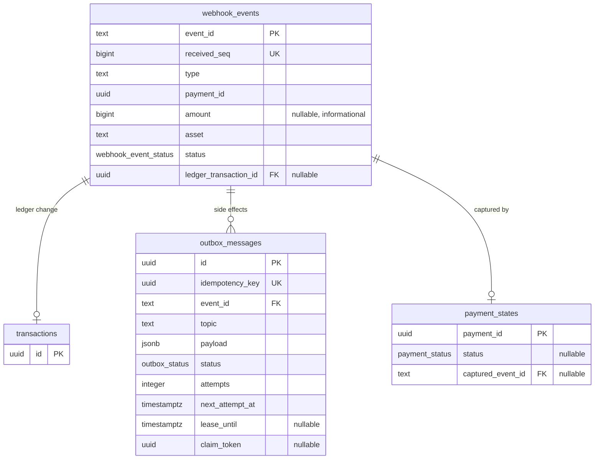

# Design Document

## Overview

`webhooks-outbox` adds signed webhook intake and a transactional outbox to `packages/core`, on top of `ledger-core`. A webhook request goes through four stages:

1. **Verify** the HMAC-SHA256 signature over `<timestamp>.<raw body>` with a constant-time compare, then check the timestamp is within 5 minutes. Nothing is parsed before this.
2. **Validate** the JSON payload: field shapes, a `bigint` amount and the ledger's asset.
3. **Apply** in one database transaction: record the event in the inbox (deduplicated by event id), lock the payment's state row, make the ledger change through `postTransaction` or `refund` on the same transaction handle, write the outbox message, and commit. Only then return `200`.
4. **Send** later, from the outbox worker: claim due messages with `FOR UPDATE SKIP LOCKED` and a lease, send each one outside any transaction with its idempotency key, then record `sent`, schedule a retry with exponential backoff, or move it to `dead`.

The package stays framework-agnostic. `handleWebhook` takes a raw body and headers and returns `{ status, body }`, and the apps wire it into Next.js route handlers. The sender and the clock are injected, so tests need no network and control time.

Everything here was checked against the current `ledger-core` code. Three facts from it drive the design:

- `postTransaction(db, input, tx)` requires the idempotency key to be claimed already on `tx`, because `transactions.idempotency_key` is a foreign key to `idempotency_records`. The webhook path therefore claims a key derived from the event id before posting.
- `refund(db, input)` has no caller-transaction parameter today. Requirement 7 adds one, built the same way as `postTransaction`'s.
- Drizzle's nested `tx.transaction()` is a real savepoint on pglite. I verified this with a scratch test (since deleted): the inner insert rolled back, and the outer transaction carried on and committed. The design uses savepoints so that a refund rejected by the cap rolls back only its own work, and the event can still be recorded as `rejected` in the same transaction.

---

## Design Decisions

The three open questions from review are settled (`docs/webhooks-outbox-design-answers.md`), and the requirements were updated to match.

### D1. Property 2 covers valid rail histories only (Requirement 5.10)

Two kinds of event sets make the outcome depend on delivery order, and the payload has no sequence number to recover the rail's order:

- **Two distinct captures for one payment.** Requirement 5.4 applies the first capture to arrive and rejects the second, so the amounts that land depend on order.
- **Refunds that together exceed the capture.** Requirement 5.8 rejects whichever refund no longer fits, so which one is rejected depends on order.

Requirement 5.10 is therefore limited to **Valid_Rail_Histories**: each payment has at most one capture, and its refunds sum to no more than the capture. Duplicates, any interleaving across payments, refunds that arrive before their capture, `pending` events and unknown event types all stay inside the property's domain. Histories outside it keep the defined behavior of Requirements 5.4 and 5.8 (record `rejected`, change nothing) and are covered by example-based unit tests.

### D2. An outbox attempt is counted when the message is claimed (Requirements 9.5, 9.6, 9.9)

If attempts were counted on failure, a message whose send crashes the worker every time would never fail visibly. Its lease would expire, it would be reclaimed and resent, and it would never reach `dead`. Instead:

- the claim transaction increments `attempts` before the sender is called, so a send that fails or crashes has used one attempt;
- a send that fails on the attempt whose count equals `maxAttempts` moves the message to `dead`;
- a message claimed while `attempts` already equals `maxAttempts` (the previous attempt was interrupted) moves to `dead` without being sent.

A dead message therefore always has `attempts = maxAttempts`, and the sender was called at most `maxAttempts` times for it. The count is exactly `maxAttempts` when no crash interrupted a claimed attempt.

### D3. Header names and signature encoding

The rail is simulated, so this spec defines the format. The headers are `ossuary-timestamp` (Unix seconds) and `ossuary-signature` (64 lowercase hex characters), and header lookup is case-insensitive. Separating the timestamp from the body with `.` keeps the signed bytes unambiguous.

---

## Architecture

```
packages/core/
├── src/
│   ├── webhooks/
│   │   ├── verify.ts          # verifyWebhook, signWebhook (HMAC, constant-time, tolerance)
│   │   ├── parse.ts           # parseEvent: JSON → Event, bigint amount, asset check
│   │   ├── keys.ts            # uuidV5 + ledgerKeyFor(eventId), outboxKeyFor(eventId, topic)
│   │   ├── handler.ts         # createWebhookHandler(db, config) → handleWebhook(request)
│   │   └── apply.ts           # applyEvent(tx, ...) per type, parking, refunds in savepoints
│   ├── outbox/
│   │   ├── worker.ts          # runOutboxOnce(db, config)
│   │   └── backoff.ts         # nextDelayMs(attempts, base, max)
│   ├── ledger/
│   │   └── refund.ts          # + optional callerTx (Requirement 7); otherwise unchanged
│   ├── schema/
│   │   ├── webhookEvents.ts   # webhook_events + webhook_event_status enum
│   │   ├── paymentStates.ts   # payment_states + payment_status enum
│   │   ├── outboxMessages.ts  # outbox_messages + outbox_status enum
│   │   └── index.ts           # + re-exports
│   ├── migrations/
│   │   ├── 0005_create_webhook_events.sql
│   │   ├── 0006_create_payment_states.sql
│   │   └── 0007_create_outbox_messages.sql
│   └── index.ts               # + createWebhookHandler, verifyWebhook, signWebhook, runOutboxOnce, types
└── tests/
    ├── helpers/
    │   ├── crash.ts           # crash injection extracted from atomicity.property.ts, shared
    │   ├── clock.ts           # fakeClock(startMs) with advance(ms)
    │   ├── sender.ts          # fakeSender(outcomes) recording every call
    │   └── webhooks.ts        # arbitraries for rail histories and signed deliveries
    ├── unit/                  # verify, parse, keys, handler, refundTx, backoff, worker
    └── property/
        ├── staleTimestamp.property.ts   # Property 1
        ├── webhookOrder.property.ts     # Property 2
        └── outboxDurability.property.ts # Property 3
```

The dependency flow is one-way: `webhooks/` → `ledger/` + `outbox` schema; `outbox/` → schema only. `ledger/` does not import `webhooks/` or `outbox/`, so `ledger-core` stays usable alone.

---

## Components and Interfaces

### `webhooks/verify.ts`

```ts
export interface Clock { now(): number } // milliseconds since epoch

export type VerifyResult =
  | { ok: true; timestamp: number }
  | { ok: false; reason: 'missing_header' | 'malformed_signature' | 'bad_signature' | 'malformed_timestamp' | 'stale' | 'future' };

export function verifyWebhook(args: {
  secret: Uint8Array | string;
  rawBody: Uint8Array | string;
  headers: Headers | Record<string, string | undefined>;
  clock: Clock;
  toleranceSeconds?: number; // default 300
}): VerifyResult;

/** Used by tests and by the simulated rail. Same Signed_Payload as verifyWebhook. */
export function signWebhook(secret: Uint8Array | string, timestamp: number, rawBody: Uint8Array | string): string;
```

Order of checks, matching Requirements 1 and 2:

1. Read the `ossuary-timestamp` and `ossuary-signature` headers case-insensitively. If either is missing, return `missing_header`.
2. If the signature is not `/^[0-9a-f]{64}$/`, return `malformed_signature`. This runs before any comparison, so a wrong-length input never reaches the compare.
3. If the timestamp header is not `/^[0-9]{1,15}$/`, return `malformed_timestamp`. The header is not trusted yet; it is only used as signed input.
4. Compute `mac = HMAC-SHA256(secret, concat(utf8(timestamp + '.'), rawBodyBytes))`. A string `rawBody` is UTF-8 encoded; the apps should pass the bytes from `request.arrayBuffer()` so nothing is re-encoded.
5. Compare `crypto.timingSafeEqual(Buffer.from(signature, 'hex'), mac)`. Both are 32 bytes by step 2. A mismatch returns `bad_signature`.
6. Only now use the timestamp: let `nowS = floor(clock.now() / 1000)`. If `nowS − ts > 300`, return `stale`; if `ts − nowS > 300`, return `future`. Exactly 300 seconds either way is accepted (Requirement 2.4).

The function never throws on hostile input and never echoes the secret or either signature.

### `webhooks/parse.ts`

```ts
export type EventType = 'payment.pending' | 'payment.captured' | 'payment.refunded';

export type ParsedEvent =
  | { known: true; id: string; type: EventType; paymentId: string; asset: string; amount: bigint | null }
  | { known: false; id: string; type: string; paymentId: string; asset: string };

export function parseEvent(rawBody: string, ledgerAsset: string): ParsedEvent; // throws InvalidWebhookPayloadError(field, reason)
```

- `JSON.parse` runs only on a verified body. Invalid JSON throws `InvalidWebhookPayloadError('body', 'invalid JSON')`.
- `id` must be a string of 1–255 characters. `paymentId` must be a UUID, and is lowercased.
- `asset` must equal `ledgerAsset` exactly. A mismatch throws `InvalidWebhookPayloadError('asset', ...)`. Nothing is converted.
- For `payment.captured` and `payment.refunded`, `amount` must match `/^[1-9][0-9]{0,18}$/`, and `BigInt(amount)` must be at most `9223372036854775807n`. A JSON number in this field is rejected, so precision can never be lost.
- `payment.pending` ignores `amount` and stores it as null.
- Any other `type` string gives `known: false` (Requirement 3.5). The other fields are still validated, because they are stored.

### `webhooks/keys.ts`

```ts
export function uuidV5(namespace: string, name: string): string;          // RFC 4122 §4.3, SHA-1
export const LEDGER_KEY_NAMESPACE = 'e2dd6ea3-afb0-4b40-9eea-7be99517c2cd';
export const OUTBOX_KEY_NAMESPACE = 'b3328300-043a-4c7a-8156-46bf9f8a1e00';
export const ledgerKeyFor = (eventId: string) => uuidV5(LEDGER_KEY_NAMESPACE, eventId);
export const outboxKeyFor = (eventId: string, topic: string) => uuidV5(OUTBOX_KEY_NAMESPACE, `${topic}\n${eventId}`);
```

The idempotency columns are `uuid`, and rail event ids are arbitrary strings, so both keys are UUIDv5 derivations. The same event always gives the same keys (Requirements 6.4 and 8.3). Using separate namespaces keeps ledger keys and outbox keys from colliding. The implementation is checked against the RFC 4122 vector `uuidV5(DNS, 'www.example.com') = 2ed6657d-e927-568b-95e1-2665a8aea6a2`, which I confirmed with `node:crypto`.

### `webhooks/handler.ts`

```ts
export interface WebhookConfig {
  secret: Uint8Array | string;          // ≥ 32 bytes
  asset: string;                        // e.g. 'USDC'
  clearingAccountId: string;            // asset, allow_overdraft = true
  revenueAccountId: string;             // revenue
  clock: Clock;
}

export interface WebhookRequest { rawBody: Uint8Array | string; headers: Headers | Record<string, string | undefined> }
export interface WebhookResponse { status: 200 | 400 | 401 | 500; body: { ok: boolean; outcome?: InboxOutcome; error?: string } }
export type InboxOutcome = 'applied' | 'parked' | 'ignored' | 'rejected' | 'duplicate';

export async function createWebhookHandler(db: Db, config: WebhookConfig):
  Promise<(request: WebhookRequest) => Promise<WebhookResponse>>;
```

`createWebhookHandler` checks the configuration once, before any request is handled (Requirement 10.3):

- The secret is at least 32 bytes.
- The asset is a non-empty string.
- Both accounts exist. The clearing account is an `asset` with `allow_overdraft`, and the revenue account is of type `revenue`.

Any failure throws an error that names the problem, and nothing is written.

The returned handler never throws. Each failure maps to a status:

| Stage | Result | Status | Body |
|---|---|---|---|
| Verify fails (any reason) | nothing written | `401` | `{ ok: false, error: 'unauthorized' }` (the reason is not disclosed) |
| Parse fails | nothing written | `400` | `{ ok: false, error: '<field>: <reason>' }` |
| Duplicate event id | nothing written | `200` | `{ ok: true, outcome: 'duplicate' }` |
| Applied, parked, ignored or rejected | committed | `200` | `{ ok: true, outcome }` |
| Any other error inside the transaction | rolled back | `500` | `{ ok: false, error: 'internal' }` |

### `webhooks/apply.ts`

This is the core of Requirements 4–6, and it runs inside one `db.transaction()`.

```ts
export async function applyEvent(tx: Tx, db: Db, cfg: WebhookConfig, event: ParsedEvent, rawBody: string): Promise<InboxOutcome>;
```

The flows are described in Operation Flows below.

### `ledger/refund.ts` (Requirement 7)

```ts
export async function refund(db: Db, input: RefundInput, callerTx?: Tx): Promise<PostTransactionResult>;
```

The body of today's transaction callback (lock the payment's rows, compute the cap, allocate, post) moves into an internal `refundOnTx(tx, db, pid, amount, idempotencyKey)`.

- **Without `callerTx`:** validate, hash, open the transaction, `claimOrReplay`, `refundOnTx`, then `completeKey`. Behavior is identical to today, and every existing `ledger-core` test must pass unchanged.
- **With `callerTx`:** validate and lowercase as today, then call `refundOnTx(callerTx, ...)` directly. The caller is responsible for claiming the key, checking the request hash, and marking the key completed. This mirrors the `postTransaction` contract, and the JSDoc says so.

### `outbox/worker.ts` and `outbox/backoff.ts`

```ts
export interface OutboxMessageToSend { idempotencyKey: string; topic: string; payload: OutboxPayload }
export type Sender = (message: OutboxMessageToSend) => Promise<void>; // throws on failure

export interface OutboxConfig {
  sender: Sender;
  clock: Clock;
  batchSize: number;    // default 50
  leaseMs: number;      // default 60_000
  baseDelayMs: number;  // default 1_000
  maxDelayMs: number;   // default 3_600_000
  maxAttempts: number;  // default 8
}

export interface OutboxRunResult { claimed: number; sent: number; failed: number; dead: number }

export async function runOutboxOnce(db: Db, config: OutboxConfig): Promise<OutboxRunResult>;
export function nextDelayMs(attempts: number, baseDelayMs: number, maxDelayMs: number): number; // min(max, base × 2^(attempts − 1))
```

Backoff has no jitter, so it is deterministic and tests can assert exact times. Jitter can be added later behind configuration without changing the schema.

---

## Data Models

### `schema/webhookEvents.ts`

```ts
export const webhookEventStatus = pgEnum('webhook_event_status', ['applied', 'parked', 'ignored', 'rejected']);

export const webhookEvents = pgTable('webhook_events', {
  eventId:             text('event_id').primaryKey(),                 // the dedupe constraint (Req 4.1)
  receivedSeq:         bigint('received_seq', { mode: 'bigint' }).generatedAlwaysAsIdentity().notNull().unique(),
  type:                text('type').notNull(),                         // raw string; unknown types are kept
  paymentId:           uuid('payment_id').notNull(),
  amount:              bigint('amount', { mode: 'bigint' }),           // null for pending and unknown types
  asset:               text('asset').notNull(),
  rawBody:             text('raw_body').notNull(),
  status:              webhookEventStatus('status').notNull(),
  rejectionReason:     text('rejection_reason'),
  ledgerTransactionId: uuid('ledger_transaction_id').references(() => transactions.id),
  receivedAt:          timestamp('received_at', { withTimezone: true }).notNull().defaultNow(),
  appliedAt:           timestamp('applied_at', { withTimezone: true }),
}, (t) => [index('webhook_events_parked_idx').on(t.paymentId, t.receivedSeq).where(sql`status = 'parked'`)]);
```

`event_id` is the primary key, which gives the unique constraint. `received_seq` records arrival order, which decides the order parked refunds are applied in (Requirement 5.7). `amount` records what the rail claimed. It never counts toward a balance: only `entries.amount` does (Requirement 11.3). The partial index serves the "parked refunds for this payment" query.

### `schema/paymentStates.ts`

```ts
export const paymentStatus = pgEnum('payment_status', ['pending', 'captured', 'refunded']);

export const paymentStates = pgTable('payment_states', {
  paymentId:       uuid('payment_id').primaryKey(),
  status:          paymentStatus('status'),                                    // null = no state recorded yet
  capturedEventId: text('captured_event_id').references(() => webhookEvents.eventId),
  updatedAt:       timestamp('updated_at', { withTimezone: true }).notNull().defaultNow(),
});
```

The row also serves as the per-payment lock. Every event for a payment locks it with `FOR UPDATE` before deciding anything. `status` is allowed to be null so the row can be created and locked before any state has been chosen. `captured_event_id` records which event's capture was applied, and is what Requirement 5.4 checks against.

### `schema/outboxMessages.ts`

```ts
export const outboxStatus = pgEnum('outbox_status', ['pending', 'sent', 'dead']);

export const outboxMessages = pgTable('outbox_messages', {
  id:             uuid('id').primaryKey(),
  idempotencyKey: uuid('idempotency_key').notNull().unique(),          // Req 8.3
  eventId:        text('event_id').notNull().references(() => webhookEvents.eventId),
  topic:          text('topic').notNull(),
  payload:        jsonb('payload').notNull(),                          // OutboxPayload, amounts as strings
  status:         outboxStatus('status').notNull().default('pending'),
  attempts:       integer('attempts').notNull().default(0),
  nextAttemptAt:  timestamp('next_attempt_at', { withTimezone: true }).notNull(),
  leaseUntil:     timestamp('lease_until', { withTimezone: true }),
  claimToken:     uuid('claim_token'),
  lastError:      text('last_error'),
  sentAt:         timestamp('sent_at', { withTimezone: true }),
  createdAt:      timestamp('created_at', { withTimezone: true }).notNull().defaultNow(),
}, (t) => [index('outbox_due_idx').on(t.status, t.nextAttemptAt)]);
```

```ts
export interface OutboxPayload {
  eventId: string; paymentId: string; ledgerTransactionId: string;
  asset: string; amount: string; // decimal minor units, never a JSON number (Req 8.2)
}
```

`next_attempt_at` and `lease_until` are written with the injected clock's time, not `now()`, so tests control them. `claim_token` fences stale results: a worker whose lease expired cannot overwrite the result recorded by the worker that reclaimed the message. Nothing ever deletes an outbox row (Requirement 8.6).

### Migrations

`0005`–`0007` are generated by drizzle-kit, one table per file in dependency order, after `0004_append_only_trigger`.

### Entity-Relationship Diagram



---

## Operation Flows

### `handleWebhook(request)`

1. Call `verifyWebhook`. On any failure, return `401`. Nothing has been parsed or written.
2. Decode the raw bytes as UTF-8 and call `parseEvent`. On failure, return `400` with the field. Nothing is written.
3. Run `db.transaction(tx => applyEvent(tx, db, config, event, rawBody))`.
4. If it returns, the transaction has committed, so return `200` with the outcome. If it throws, the transaction has rolled back; return `500`.

### `applyEvent` — common prefix

1. **Inbox claim (Req 4.2).** Run `INSERT INTO webhook_events (event_id, type, payment_id, amount, asset, raw_body, status) VALUES (..., 'applied') ON CONFLICT (event_id) DO NOTHING RETURNING event_id`.
   - If no row comes back, the event id exists, so return `duplicate`. Nothing else runs, and the stored row is unchanged, even if this delivery's payload differs (Req 4.4).
   - The status is written as provisional `applied` and corrected below. The row is created in this same transaction, so only the final status is ever visible.
   - A concurrent delivery of the same id waits on the primary key until this transaction commits, then gets no row back and returns `duplicate` (Req 4.5).
2. **Unknown type:** set the status to `ignored` and return `ignored`.
3. **Payment lock:** run `INSERT INTO payment_states (payment_id) VALUES ($p) ON CONFLICT DO NOTHING`, then `SELECT status, captured_event_id FROM payment_states WHERE payment_id = $p FOR UPDATE`. Events for the same payment are now serialized.
4. Branch on the type, as below.

### `payment.pending`

- If `status` is null, set it to `pending`. Otherwise leave it unchanged, which is the forward-only rule (Req 5.1 and 5.9).
- The inbox status stays `applied`. There is no ledger change and no outbox message (Req 5.2).

### `payment.captured`

1. If `captured_event_id` is not null, set the inbox status to `rejected` with reason `duplicate capture` and return `rejected` (Req 5.4).
2. `postCapture` inside a savepoint (`tx.transaction(async sp => ...)`):
   1. `key = ledgerKeyFor(eventId)`, then `claimOrReplay(sp, key, hashPayload({ op: 'webhook', eventId }))`. If the claim returns a stored response, the ledger change already exists, so reuse it. That is defensive only: the inbox dedupe makes it unreachable.
   2. `postTransaction(db, { idempotencyKey: key, kind: 'capture', paymentId, entries: [{ clearing, +amount }, { revenue, −amount }] }, sp)`.
   3. `completeKey(sp, key, response)`.
3. Set `captured_event_id = eventId`, and raise `status` to `captured` if it ranks lower. Set the inbox row's `ledger_transaction_id` and `applied_at`.
4. Insert the outbox message: topic `payment.captured`, key `outboxKeyFor(eventId, topic)`, `next_attempt_at = clock.now()` (Req 8.1 and 8.5).
5. **Apply parked refunds (Req 5.7):** `SELECT ... FROM webhook_events WHERE payment_id = $p AND status = 'parked' ORDER BY received_seq FOR UPDATE`. For each row, run the refund flow below and set its status to `applied` or `rejected`.
6. Return `applied`.

### `payment.refunded`

1. If `captured_event_id` is null, set the inbox status to `parked` and return `parked`. There is no ledger change and no outbox message (Req 5.6).
2. Run `applyRefund(eventId, amount)`, which is also used for parked refunds:
   1. Open a savepoint. In it, claim `ledgerKeyFor(eventId)` as above, call `refund(db, { idempotencyKey: key, paymentId, amount }, sp)`, then `completeKey(sp, key, response)`.
   2. If this throws `RefundCapExceededError`, the savepoint rolls back the key claim and anything else in it. Set the inbox status to `rejected` with reason `refund exceeds remaining <R>` (Req 5.8). There is no outbox message.
   3. Any other error propagates and rolls back the whole event, which gives a `500`.
   4. On success, raise `status` to `refunded`, set `ledger_transaction_id` and `applied_at`, and insert the outbox message with topic `payment.refunded`.
3. Return `applied` or `rejected`.

### Lock order (Requirement 6.5)

Every webhook transaction acquires locks in this order:

1. The `webhook_events` row for this event id (the inbox insert).
2. The `payment_states` row for the payment (`FOR UPDATE`).
3. The parked `webhook_events` rows for the payment (capture events only, `ORDER BY received_seq FOR UPDATE`).
4. The ledger key row in `idempotency_records` (the claim).
5. The payment's `transactions` rows, `ORDER BY id FOR UPDATE` (inside `refund`).
6. The account rows, `ORDER BY account_id FOR UPDATE` (inside `postTransaction`).

Steps 4–6 are exactly the ledger's own order. A plain `refund` or `postTransaction` call from outside the webhook path takes only locks 4–6, in the same order. Lock 1 is unique per event id and lock 2 is taken before any ledger lock, so no lock cycle exists. Lock 3 rows belong to the same payment and are taken in `received_seq` order, after lock 2 has serialized that payment's events. pglite has one connection, so this ordering is argued here and is not exercised by a concurrency test. A real-Postgres concurrency test is out of scope.

### Outbox worker: `runOutboxOnce(db, config)`

Let `now = clock.now()`. Then:

1. **Claim** in a short transaction:
   ```sql
   SELECT id, idempotency_key, topic, payload, attempts FROM outbox_messages
   WHERE status = 'pending' AND next_attempt_at <= $now AND (lease_until IS NULL OR lease_until <= $now)
   ORDER BY next_attempt_at, id
   LIMIT $batch
   FOR UPDATE SKIP LOCKED
   ```
   For each row:
   - If `attempts >= maxAttempts`, set `status = 'dead'` and don't send it. This is the crash-loop guard from D2: the previous claimed attempt was interrupted before its result was recorded.
   - Otherwise set `attempts = attempts + 1`, `lease_until = now + leaseMs`, and `claim_token = randomUUID()`.

   Commit. `SKIP LOCKED` lets concurrent workers pick disjoint rows, and the lease keeps the rows exclusive after commit (Req 9.1 and 9.2).
2. **Send** each claimed message with `config.sender({ idempotencyKey, topic, payload })`, sequentially and outside any transaction (Req 9.3).
3. **Record** each result in its own statement, fenced by the claim token:
   - **Success:** `UPDATE ... SET status = 'sent', sent_at = $now, lease_until = NULL WHERE id = $id AND claim_token = $token`.
   - **Failure, attempts below `maxAttempts`:** set `last_error` to the error message truncated to 1,000 characters, `next_attempt_at = now + nextDelayMs(attempts, base, max)`, and `lease_until = NULL`, with the same fence.
   - **Failure at `maxAttempts`:** set `status = 'dead'` and `last_error`, with the same fence.
   - A result update that matches 0 rows means the lease expired and another worker took the message over. The stale result is dropped, and the receiver deduplicates the extra send by its idempotency key.
4. **Crash recovery:** if the process dies after step 1, the leases expire and the messages are claimed again with the same idempotency key (Req 9.7). Sends are at-least-once, never at-most-once.

---

## Error Handling

| Error | Where | Effect |
|---|---|---|
| Verification failure (any reason) | `verifyWebhook` | `401`, nothing written, reason hidden from the response |
| `InvalidWebhookPayloadError(field, reason)` | `parseEvent` | `400`, nothing written |
| Invalid configuration (short secret, missing or wrong-type account) | `createWebhookHandler` | throws at startup, before any request |
| Duplicate event id | inbox claim | `200 duplicate`, nothing written |
| Duplicate capture for a payment | capture flow | `200 rejected`, inbox row recorded, no ledger change, no outbox |
| `RefundCapExceededError` | refund savepoint | `200 rejected`, savepoint rolled back, no outbox |
| Any other error in the transaction | anywhere in `applyEvent` | full rollback, `500`, rail retries |
| Sender failure | worker | attempt recorded, retried with backoff, `dead` at the limit |

`InvalidWebhookPayloadError` is new and extends `LedgerError`, like the other typed errors. No error message or response body includes the secret, either signature, or the raw body (Requirements 1.6 and 10.4).

---

## Correctness Properties

*A property is a characteristic or behavior that should hold true across all valid executions of a system — essentially, a formal statement about what the system should do. Properties serve as the bridge between human-readable specifications and machine-verifiable correctness guarantees.*

### Property 1: A replayed old timestamp is always rejected

*For any* event body, valid or not, signed correctly with a timestamp more than 300 seconds before the clock's current time, `handleWebhook` SHALL return `401`. The `webhook_events`, `payment_states`, `outbox_messages`, `transactions` and `entries` tables SHALL be unchanged.

The generated age ranges from 301 seconds to about 10 years, with extra weight near the 301-second boundary. Each run also checks the same body with a fresh timestamp, to confirm the rejection is about age and not a bad signature.

**Validates: Requirements 2.2, 2.6, 1.1**

### Property 2: Delivery order and duplicates don't change the outcome

*For any* Valid_Rail_History (D1) over 1–4 payments, where each payment has an optional `pending`, at most one capture, and refunds summing to no more than the capture, plus optional unknown-type events, and *for any* delivery sequence that is a permutation of those events with up to 2× duplicate deliveries, interleaved across payments:

- every delivery SHALL return `200`;
- the final clearing and revenue balances, every payment's `payment_states.status`, and every event's inbox status SHALL equal those from delivering each distinct event once in natural order;
- there SHALL be exactly one outbox message per ledger-changing event.

Refunds that arrive before their capture are included, so the parking path is exercised. The reference run uses its own accounts, payment ids and event ids, mapped one-to-one, in the same database.

**Validates: Requirements 5.10, 4.3, 5.6, 5.7, 5.9, 8.1**

### Property 3: The outbox never loses an event across crashes

*For any* valid rail history, *any* schedule of sender outcomes (success or failure), and *any* set of crash points:

- crash points during event application are before each SQL statement of `applyEvent`, before commit, and after commit;
- crash points during the worker are before claim, after the claim commits, after send, and after the result is recorded.

After the rail retries every non-`2xx` delivery, and the worker runs with the clock advanced past every lease and backoff until no message is due, the worker SHALL reach that point within `messages × maxAttempts + 1` rounds (a worker that never drains, such as one that retries a crash loop forever, fails the property), and then:

- every event whose ledger change committed SHALL have exactly one outbox message;
- each such message SHALL be `sent`, with the sender called at least once with its idempotency key, or `dead`, with `attempts = maxAttempts` (counted at claim, D2) and the sender called at most `maxAttempts` times, and exactly `maxAttempts` times when no crash interrupted one of its attempts;
- no outbox message SHALL exist for an event without a committed ledger change;
- no message SHALL ever be deleted.

**Validates: Requirements 9.9, 6.1, 6.3, 6.6, 8.1, 8.6, 9.6, 9.7**

### Mutation checks (Requirement 12.5)

Each property is run against these deliberate breaks before its task is marked done, and each break must make the property fail:

| Property | Break |
|---|---|
| 1 | Skip the timestamp check. Or widen the tolerance to 300,000 s. |
| 2 | Drop the inbox dedupe (`ON CONFLICT` → plain insert with a fresh internal id). Or apply refunds to an uncaptured payment as `rejected` instead of `parked`. Or let `pending` overwrite `captured`. |
| 3 | Write the outbox message in a separate transaction after commit. Or mark `sent` before calling the sender. Or skip the lease check in the claim query. Or count the attempt on failure instead of at claim (D2), which never drains under a crash-every-send schedule. |

---

## Testing Strategy

### Tooling

- Vitest, fast-check and pglite, as in `ledger-core`. The shared `runConfig` from `tests/helpers/arbitraries.ts` provides the 45-second interrupt-as-failure bound. Every webhooks-outbox property runs **at least 25 cases** in the default `vitest --run` (Requirement 12.2); the run counts live in one `WEBHOOK_RUNS` constant whose values a unit test asserts are all ≥ 25.
- Each property file uses one migrated database, with fresh accounts, payment ids and event ids per run (the `ledger-core` pattern).
- **Fake clock** (`tests/helpers/clock.ts`): starts at a fixed instant and only moves when `advance(ms)` is called.
- **Fake sender** (`tests/helpers/sender.ts`): takes a scripted list of outcomes and records every call (key, topic, payload) for assertions.
- **Crash injection** (`tests/helpers/crash.ts`): extracted from `ledger-core`'s `atomicity.property.ts`. It builds a second Drizzle instance on the same PGlite client, whose logger throws once before statement N, plus wrappers for "before commit" and "after commit". It also checks that a calibration run issues the expected statements. Worker crash points are injected through the sender wrapper and the same logger. No production code gains a test hook.

### Unit tests

- **`verify.test.ts`:**
  - a known-good vector, and changing any single byte of the body or timestamp is rejected;
  - missing headers, uppercase hex, wrong length and non-hex are rejected without throwing;
  - ±300 s is accepted and ±301 s is rejected;
  - a future timestamp is rejected;
  - a secret shorter than 32 bytes is rejected at configuration time.
- **`parse.test.ts`:** each field rule; an amount at exactly the `int8` maximum is accepted; maximum + 1, leading zeros, a JSON number and an exponent are rejected; an asset mismatch is rejected; an unknown type returns `known: false`.
- **`keys.test.ts`:** the RFC 4122 vector; determinism; the two namespaces never collide.
- **`handler.test.ts`:** every row of the status table; a duplicate with a different payload; a duplicate capture; a refund over the cap; a parked refund applied when its capture arrives; an injected failure inside the transaction giving `500` with nothing written; no secret or signature in any response.
- **`refundTx.test.ts`:**
  - a refund on a caller transaction commits together with the caller's own work;
  - an outer rollback removes it;
  - a cap error inside a savepoint leaves the outer transaction usable;
  - the no-`tx` path is unchanged, which the existing `refund.test.ts` keeps passing.
- **`backoff.test.ts` and `worker.test.ts`:**
  - exact backoff times and the cap;
  - `dead` at the limit;
  - an unexpired lease is not reclaimed;
  - the claim-token fence drops a stale result;
  - `SKIP LOCKED` appears in the claim SQL (concurrent workers can't be run on one pglite connection);
  - a crash-loop message is moved to `dead`.

### Property tests

- `staleTimestamp.property.ts`: Property 1.
- `webhookOrder.property.ts`: Property 2.
- `outboxDurability.property.ts`: Property 3.

Each test is tagged `// Feature: webhooks-outbox, Property N` with its requirements, and is mutation-checked as listed above.

### Time budget

The `ledger-core` suite takes about 30–37 s. The new unit files use one database per file (`beforeAll`), not one per test, which is the main cost in the existing unit tests. That keeps the full `vitest --run` well under 120 s (Requirement 12.7).

Each property runs at least 25 cases. Measured `ledger-core` costs give the estimate: a post is about 3 ms and a fresh migrated pglite about 1.8 s. Property 1 does no writes, so 100 cases cost well under a second. Property 2 delivers at most about 60 events plus a reference run of about 20 per case, so 25 cases are roughly 10 s. Property 3 is the most expensive per case, because each case replays deliveries and worker rounds after crashes, so it bounds a case to 1–2 payments and a handful of crash points. The run counts are confirmed by timing the full suite after each property task. If the full run approaches 90 s, the fix is to cut per-case size, not to drop below 25 cases.
